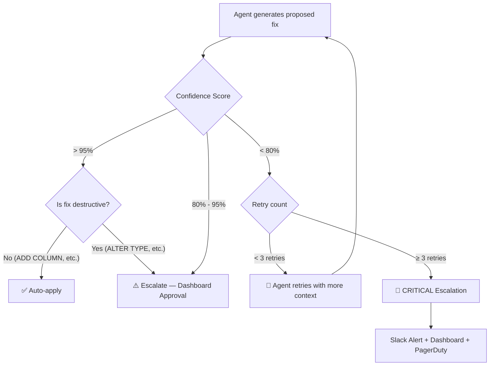
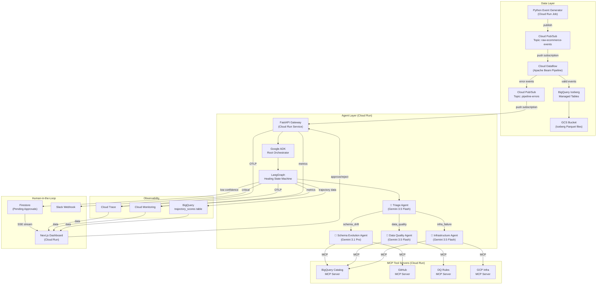
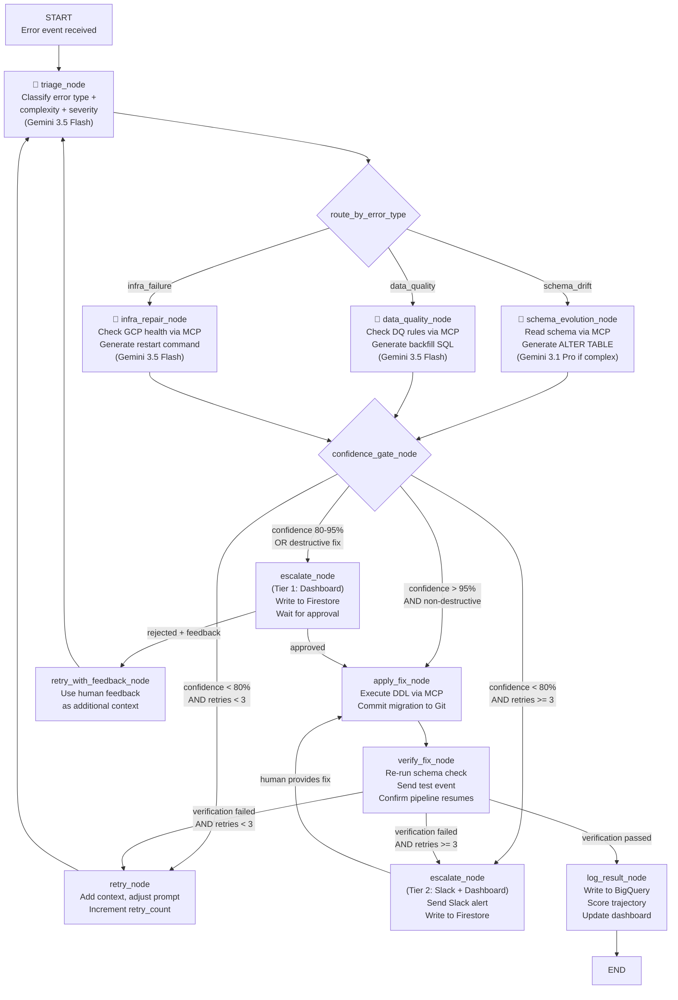

# Implementation Plan: Agentic Self-Healing Data Pipeline

## Goal

Build a production-grade **Agentic Self-Healing Data Pipeline** on GCP using a **LangGraph + Google ADK** combined architecture. The system autonomously detects, diagnoses, and repairs broken e-commerce data pipelines — with human-in-the-loop escalation for complex failures. Full Next.js dashboard. Direct GCP deployment. Google Gemini models only.

---

## Architecture Decision: LangGraph + ADK Combined

```
┌─────────────────────────────────────────────────────────┐
│              Google ADK — Root Orchestrator              │
│                                                         │
│  ┌─────────────┐   ┌──────────────┐   ┌──────────────┐ │
│  │SequentialAgt│   │ ParallelAgent│   │  LlmAgent    │ │
│  │ (Lifecycle) │   │  (Health     │   │ (Supervisor) │ │
│  │             │   │   Checks)    │   │              │ │
│  └──────┬──────┘   └──────┬───────┘   └──────┬───────┘ │
│         │                 │                   │         │
│         ▼                 ▼                   ▼         │
│  ┌─────────────────────────────────────────────────┐    │
│  │    LangGraph State Machine (as ADK AgentTool)   │    │
│  │                                                 │    │
│  │  START → Triage → Route → Specialist Agent      │    │
│  │          → Confidence Gate → Apply/Escalate     │    │
│  │          → Verify → END                         │    │
│  └─────────────────────────────────────────────────┘    │
│                          │                              │
│              ┌───────────┼───────────┐                  │
│              ▼           ▼           ▼                  │
│         MCP Server  MCP Server  MCP Server              │
│         (BigQuery)  (GitHub)    (GCP Infra)             │
└─────────────────────────────────────────────────────────┘
```

**ADK handles:** Lifecycle management, parallel health checks, supervisor oversight, A2A protocol support, GCP-native deployment to Vertex AI Agent Engine.

**LangGraph handles:** The core healing state machine — stateful graph with cyclic retry loops, conditional branching, human-in-the-loop checkpoints, durable execution.

---

## LLM Strategy

| Task Complexity | Model | Cost (per 1M tokens) | When Used |
| :--- | :--- | :--- | :--- |
| **Simple** — Triage, classification, basic DQ checks | **Gemini 3.5 Flash** | $1.50 input / $9.00 output | 80% of agent calls |
| **Complex** — Schema migration SQL generation, multi-step root cause analysis, ambiguous failures | **Gemini 3.1 Pro** | ~$3.50 input / $14.00 output | 20% of agent calls |

Routing rule: The Triage Agent classifies complexity. If `error_complexity == "complex"` → Pro. Else → Flash.

---

## Human-in-the-Loop (HITL) Design

### When Does the System Escalate to a Human?



### Escalation Tiers

| Tier | Trigger | Channel | Human Action Required |
| :--- | :--- | :--- | :--- |
| **Tier 0 — Auto-heal** | Confidence > 95%, non-destructive fix | None | None — fully autonomous |
| **Tier 1 — Soft Escalation** | Confidence 80-95% OR destructive fix | Dashboard notification | Click **Approve** or **Reject** in Next.js UI |
| **Tier 2 — Hard Escalation** | Confidence < 80% after 3 retries | Slack alert + Dashboard + Email | Review diagnosis, provide guidance, or manually fix |
| **Tier 3 — Critical** | Agent error / unexpected exception | Slack + PagerDuty | Immediate engineering response |

### Dashboard Approval Flow

The Next.js dashboard has a dedicated **"Pending Approvals"** page:
1. Agent generates fix → stores in Firestore with `status: "pending_approval"`
2. Dashboard polls Firestore via SSE → shows pending item with: error details, proposed DDL, rollback DDL, confidence score, agent's reasoning chain
3. Engineer clicks **Approve** → backend applies fix → agent verifies → marks `status: "applied"`
4. Engineer clicks **Reject + Comment** → agent receives feedback, attempts alternative fix
5. Engineer clicks **Manual Override** → takes direct control, writes custom fix

---

## Complete GCP Architecture



---

## GCP Services Used

| Service | Purpose | Free Tier Coverage |
| :--- | :--- | :--- |
| **Cloud Pub/Sub** | Event streaming (raw events + error events) | 10 GB/month ✅ |
| **Cloud Dataflow** | Apache Beam streaming pipeline | ❌ Paid (~$0.056/vCPU-hr) |
| **BigQuery** | Iceberg managed tables + analytics | 1 TB queries/month ✅ |
| **GCS** | Iceberg Parquet file storage | 5 GB ✅ |
| **Cloud Run** | Agent service + MCP servers + Next.js dashboard | 2M requests/month ✅ |
| **Vertex AI** | Gemini 3.5 Flash + 3.1 Pro | Pay-per-token |
| **Firestore** | HITL pending approvals + agent state | 1 GB storage ✅ |
| **Cloud Trace** | OpenTelemetry trace ingestion | 5M spans/month ✅ |
| **Cloud Monitoring** | Dashboards + alerting | ✅ |
| **Artifact Registry** | Docker image storage | 500 MB ✅ |
| **Cloud Build** | CI/CD pipeline | 120 min/day ✅ |
| **Secret Manager** | API keys + service credentials | 6 active versions ✅ |

---

## Project Structure

```
agentic-self-healing-pipeline/
│
├── README.md
├── LICENSE
├── Makefile
├── .gitignore
├── .env.example
├── .gcloudignore
│
├── docs/
│   ├── architecture.md              # Full architecture documentation
│   ├── adlc-report.md               # ADLC lifecycle documentation
│   ├── api-reference.md             # API endpoint documentation
│   └── demo-script.md               # 5-minute video demo script
│
│
│ ═══════════════════════════════════════════════════════
│  BACKEND — Python (FastAPI + LangGraph + ADK + MCP)
│ ═══════════════════════════════════════════════════════
│
├── backend/
│   ├── pyproject.toml
│   ├── requirements.txt
│   ├── Dockerfile
│   ├── .env.example
│   │
│   ├── app/
│   │   ├── __init__.py
│   │   ├── main.py                  # FastAPI application entry point
│   │   ├── config.py                # Settings (GCP project, model names, thresholds)
│   │   │
│   │   ├── api/                     # ── REST API Routes ──
│   │   │   ├── __init__.py
│   │   │   ├── health.py            # GET /health — liveness + readiness probes
│   │   │   ├── events.py            # POST /api/events/error — Pub/Sub push endpoint
│   │   │   ├── approvals.py         # GET/POST /api/approvals — HITL approval endpoints
│   │   │   ├── dashboard.py         # GET /api/dashboard/* — dashboard data endpoints
│   │   │   ├── stream.py            # GET /api/stream/events — SSE endpoint for real-time
│   │   │   └── triggers.py          # POST /api/triggers/* — manual injection endpoints
│   │   │
│   │   ├── middleware/              # ── Middleware ──
│   │   │   ├── __init__.py
│   │   │   ├── auth.py              # GCP IAM / API key authentication
│   │   │   ├── tracing.py           # OpenTelemetry OTLP middleware
│   │   │   └── error_handler.py     # Global exception handler
│   │   │
│   │   ├── orchestrator/           # ── Google ADK Root Orchestrator ──
│   │   │   ├── __init__.py
│   │   │   ├── root_agent.py        # ADK SequentialAgent — root pipeline lifecycle
│   │   │   ├── health_checker.py    # ADK ParallelAgent — parallel GCP health checks
│   │   │   ├── supervisor.py        # ADK LlmAgent — high-level oversight + escalation
│   │   │   └── adk_langgraph_bridge.py  # Wraps LangGraph graph as ADK AgentTool
│   │   │
│   │   ├── agents/                  # ── LangGraph Healing State Machine ──
│   │   │   ├── __init__.py
│   │   │   ├── state.py             # PipelineHealingState TypedDict
│   │   │   ├── graph.py             # Main LangGraph StateGraph definition
│   │   │   ├── nodes/
│   │   │   │   ├── __init__.py
│   │   │   │   ├── triage.py        # Triage node — classify error type + complexity
│   │   │   │   ├── schema_evolution.py  # Schema drift healing node
│   │   │   │   ├── data_quality.py  # Data quality healing node
│   │   │   │   ├── infra_repair.py  # Infrastructure repair node
│   │   │   │   ├── confidence_gate.py   # Routes to auto-apply or HITL
│   │   │   │   ├── apply_fix.py     # Executes the approved fix
│   │   │   │   ├── verify_fix.py    # Post-fix verification
│   │   │   │   └── escalate.py      # HITL escalation (Firestore + Slack)
│   │   │   ├── edges/
│   │   │   │   ├── __init__.py
│   │   │   │   ├── route_by_error_type.py   # Conditional: triage → specialist
│   │   │   │   ├── route_by_confidence.py   # Conditional: gate → apply/escalate
│   │   │   │   └── route_by_verification.py # Conditional: verify → end/retry
│   │   │   └── prompts/
│   │   │       ├── __init__.py
│   │   │       ├── triage_prompt.py         # System prompt for triage agent
│   │   │       ├── schema_evolution_prompt.py
│   │   │       ├── data_quality_prompt.py
│   │   │       └── infra_repair_prompt.py
│   │   │
│   │   ├── mcp_servers/             # ── FastMCP Tool Servers ──
│   │   │   ├── __init__.py
│   │   │   ├── bigquery_catalog.py  # BigQuery schema operations
│   │   │   ├── github_ops.py        # GitHub PR/branch/commit operations
│   │   │   ├── dq_rules_engine.py   # Data quality rules CRUD
│   │   │   └── gcp_infra.py         # GCP infrastructure management
│   │   │
│   │   ├── guardrails/              # ── Safety Layer ──
│   │   │   ├── __init__.py
│   │   │   ├── sql_validator.py     # Blocks destructive SQL operations
│   │   │   ├── output_schemas.py    # Pydantic models for structured LLM output
│   │   │   └── rate_limiter.py      # Token budget + API rate limit enforcement
│   │   │
│   │   ├── observability/           # ── Tracing + Evaluation ──
│   │   │   ├── __init__.py
│   │   │   ├── tracer.py            # OpenTelemetry → Cloud Trace setup
│   │   │   ├── trajectory_evaluator.py  # 5-metric trajectory scoring
│   │   │   ├── metrics_collector.py # Custom Cloud Monitoring metrics
│   │   │   └── cost_tracker.py      # Per-event token + GCP cost tracking
│   │   │
│   │   ├── notifications/           # ── Alert Channels ──
│   │   │   ├── __init__.py
│   │   │   ├── slack_notifier.py    # Slack webhook with rich message blocks
│   │   │   └── email_notifier.py    # SendGrid/Mailgun fallback
│   │   │
│   │   ├── models/                  # ── Data Models ──
│   │   │   ├── __init__.py
│   │   │   ├── events.py            # EcommerceEvent, ErrorEvent Pydantic models
│   │   │   ├── healing.py           # HealingResult, ApprovalRequest models
│   │   │   ├── trajectory.py        # TrajectoryScore, AgentStep models
│   │   │   └── enums.py             # ErrorType, Severity, ApprovalStatus enums
│   │   │
│   │   └── services/                # ── Business Logic ──
│   │       ├── __init__.py
│   │       ├── bigquery_service.py  # BigQuery read/write operations
│   │       ├── firestore_service.py # Firestore CRUD for approvals + state
│   │       ├── pubsub_service.py    # Pub/Sub publish/subscribe helpers
│   │       └── vertex_ai_service.py # Gemini model initialization + routing
│   │
│   ├── streaming/                   # ── Dataflow Pipeline (Separate Deployment) ──
│   │   ├── __init__.py
│   │   ├── pipeline.py              # Main Apache Beam pipeline
│   │   ├── transforms/
│   │   │   ├── __init__.py
│   │   │   ├── parse_json.py        # JSON parsing DoFn
│   │   │   ├── validate_schema.py   # Schema validation DoFn
│   │   │   ├── check_quality.py     # Data quality check DoFn
│   │   │   └── route_events.py      # Clean/error routing DoFn
│   │   └── schemas/
│   │       ├── __init__.py
│   │       ├── order_schema.py      # Order event schema definition
│   │       ├── inventory_schema.py  # Inventory event schema definition
│   │       └── user_activity_schema.py  # User activity schema definition
│   │
│   ├── data_generator/              # ── Event Simulation ──
│   │   ├── __init__.py
│   │   ├── generator.py             # Main event generator orchestrator
│   │   ├── order_events.py          # Realistic order event generator
│   │   ├── inventory_events.py      # Inventory update generator
│   │   ├── user_activity_events.py  # User clickstream generator
│   │   ├── drift_injector.py        # Schema drift injection (4 types)
│   │   ├── anomaly_injector.py      # Data quality anomaly injection
│   │   └── scenarios.py             # Pre-defined failure scenario configs
│   │
│   └── tests/
│       ├── __init__.py
│       ├── unit/
│       │   ├── test_triage_agent.py
│       │   ├── test_schema_evolution_agent.py
│       │   ├── test_sql_validator.py
│       │   ├── test_confidence_gate.py
│       │   ├── test_mcp_bigquery.py
│       │   ├── test_output_schemas.py
│       │   └── test_trajectory_evaluator.py
│       ├── integration/
│       │   ├── test_full_healing_flow.py
│       │   ├── test_hitl_approval_flow.py
│       │   ├── test_pubsub_to_agent.py
│       │   └── test_mcp_server_integration.py
│       └── evaluation/
│           ├── scenarios.json        # 200+ failure scenarios
│           └── run_evaluation.py     # Batch evaluation runner
│
│
│ ═══════════════════════════════════════════════════════
│  FRONTEND — Next.js 15 (App Router, TypeScript, SSE)
│ ═══════════════════════════════════════════════════════
│
├── frontend/
│   ├── package.json
│   ├── next.config.ts
│   ├── tsconfig.json
│   ├── tailwind.config.ts           # Using Tailwind only because you said Next.js
│   ├── postcss.config.js
│   ├── Dockerfile
│   ├── .env.example
│   │
│   ├── public/
│   │   ├── favicon.ico
│   │   └── logo.svg
│   │
│   ├── src/
│   │   ├── app/                     # ── App Router Pages ──
│   │   │   ├── layout.tsx           # Root layout (dark theme, sidebar nav)
│   │   │   ├── page.tsx             # Dashboard home — overview metrics
│   │   │   ├── globals.css          # Global styles + design tokens
│   │   │   │
│   │   │   ├── pipeline/
│   │   │   │   └── page.tsx         # Pipeline Health — real-time event flow
│   │   │   │
│   │   │   ├── agents/
│   │   │   │   ├── page.tsx         # Agent Actions — healing event log
│   │   │   │   └── [id]/
│   │   │   │       └── page.tsx     # Agent Detail — single healing replay
│   │   │   │
│   │   │   ├── approvals/
│   │   │   │   ├── page.tsx         # Pending Approvals — HITL queue
│   │   │   │   └── [id]/
│   │   │   │       └── page.tsx     # Approval Detail — review + approve/reject
│   │   │   │
│   │   │   ├── evaluation/
│   │   │   │   └── page.tsx         # Trajectory Scores — 5-metric charts
│   │   │   │
│   │   │   ├── costs/
│   │   │   │   └── page.tsx         # Cost Tracker — token + GCP spend
│   │   │   │
│   │   │   └── api/                 # ── Next.js API Routes ──
│   │   │       └── stream/
│   │   │           └── route.ts     # SSE proxy to backend /api/stream/events
│   │   │
│   │   ├── components/              # ── Reusable Components ──
│   │   │   ├── layout/
│   │   │   │   ├── Sidebar.tsx      # Sidebar navigation
│   │   │   │   ├── Header.tsx       # Top bar with status indicators
│   │   │   │   └── PageWrapper.tsx  # Page container with breadcrumbs
│   │   │   │
│   │   │   ├── dashboard/
│   │   │   │   ├── MetricCard.tsx           # Animated stat card
│   │   │   │   ├── PipelineStatusBadge.tsx  # Green/Yellow/Red pipeline status
│   │   │   │   ├── RecentHealingTable.tsx   # Recent healing events table
│   │   │   │   └── SystemHealthRing.tsx     # Circular health indicator
│   │   │   │
│   │   │   ├── pipeline/
│   │   │   │   ├── EventFlowChart.tsx       # Real-time event throughput chart
│   │   │   │   ├── SchemaVersionTimeline.tsx # Schema change timeline
│   │   │   │   └── ErrorRateGauge.tsx       # Error rate gauge
│   │   │   │
│   │   │   ├── agents/
│   │   │   │   ├── HealingEventCard.tsx     # Single healing event summary
│   │   │   │   ├── AgentDecisionTree.tsx    # Visual decision tree replay
│   │   │   │   ├── TrajectoryViewer.tsx     # Step-by-step agent trace
│   │   │   │   └── ConfidenceBadge.tsx      # Confidence score with color
│   │   │   │
│   │   │   ├── approvals/
│   │   │   │   ├── ApprovalCard.tsx         # Pending approval item
│   │   │   │   ├── DiffViewer.tsx           # Schema diff (old vs new)
│   │   │   │   ├── SQLPreview.tsx           # Syntax-highlighted SQL preview
│   │   │   │   ├── ApprovalActions.tsx      # Approve/Reject/Override buttons
│   │   │   │   └── FeedbackForm.tsx         # Rejection reason textarea
│   │   │   │
│   │   │   ├── evaluation/
│   │   │   │   ├── TrajectoryScoreChart.tsx  # 5-metric radar chart
│   │   │   │   ├── MTTRTrendChart.tsx        # MTTR over time
│   │   │   │   └── SuccessRateChart.tsx      # Task completion rate
│   │   │   │
│   │   │   ├── costs/
│   │   │   │   ├── TokenUsageChart.tsx       # Token spend per model
│   │   │   │   ├── CostBreakdownTable.tsx    # Per-event cost breakdown
│   │   │   │   └── GCPBillingCard.tsx        # Estimated GCP spend
│   │   │   │
│   │   │   └── shared/
│   │   │       ├── StatusDot.tsx             # Animated status indicator
│   │   │       ├── LoadingSkeleton.tsx       # Loading state skeleton
│   │   │       ├── EmptyState.tsx            # Empty state illustration
│   │   │       ├── CodeBlock.tsx             # Syntax-highlighted code
│   │   │       └── TimeAgo.tsx              # Relative time display
│   │   │
│   │   ├── hooks/                   # ── Custom Hooks ──
│   │   │   ├── useSSE.ts            # Server-Sent Events hook
│   │   │   ├── useApprovals.ts      # Approval CRUD operations
│   │   │   ├── useDashboardData.ts  # Dashboard data fetching
│   │   │   └── useTrajectory.ts     # Trajectory data fetching
│   │   │
│   │   ├── lib/                     # ── Utilities ──
│   │   │   ├── api.ts               # API client (fetch wrapper)
│   │   │   ├── constants.ts         # App constants
│   │   │   ├── formatters.ts        # Number/date/duration formatters
│   │   │   └── types.ts             # Shared TypeScript types
│   │   │
│   │   └── styles/
│   │       └── theme.ts             # Design system tokens
│   │
│   └── __tests__/
│       ├── components/
│       │   ├── MetricCard.test.tsx
│       │   └── ApprovalCard.test.tsx
│       └── hooks/
│           └── useSSE.test.ts
│
│
│ ═══════════════════════════════════════════════════════
│  INFRASTRUCTURE — Terraform + Docker + CI/CD
│ ═══════════════════════════════════════════════════════
│
├── infra/
│   ├── terraform/
│   │   ├── main.tf                  # Provider, project, API enablement
│   │   ├── variables.tf             # Configurable parameters
│   │   ├── outputs.tf               # Cloud Run URLs, dataset names
│   │   ├── pubsub.tf               # Topics + subscriptions
│   │   ├── bigquery.tf             # Datasets + Iceberg managed tables
│   │   ├── cloud_run.tf            # Agent + Dashboard services
│   │   ├── dataflow.tf             # Beam pipeline deployment
│   │   ├── firestore.tf            # Firestore database + indexes
│   │   ├── iam.tf                  # Service accounts + IAM bindings
│   │   ├── monitoring.tf           # Alerting policies
│   │   ├── secrets.tf              # Secret Manager entries
│   │   └── artifact_registry.tf    # Docker repository
│   │
│   └── docker/
│       ├── docker-compose.yml       # Full stack for integration testing
│       ├── Dockerfile.backend       # Python backend
│       ├── Dockerfile.frontend      # Next.js frontend
│       └── Dockerfile.dataflow      # Beam pipeline
│
├── scripts/
│   ├── setup_gcp.sh                 # One-command GCP project bootstrap
│   ├── deploy.sh                    # Full deployment script
│   ├── inject_drift.sh              # Trigger schema drift for demo
│   ├── inject_anomaly.sh            # Trigger DQ anomaly for demo
│   └── run_evaluation.sh            # Run full evaluation suite
│
└── .github/
    └── workflows/
        ├── ci.yml                   # Lint + unit tests (on every push)
        ├── deploy-backend.yml       # Backend → Cloud Run (on merge to main)
        ├── deploy-frontend.yml      # Frontend → Cloud Run (on merge to main)
        ├── deploy-pipeline.yml      # Dataflow pipeline update
        └── weekly-evaluation.yml    # Weekly trajectory evaluation
```

---

## Data Schemas

### E-Commerce Event Schemas

#### Order Event (v1 — baseline)
```python
class OrderEventV1(BaseModel):
    event_id: str                    # UUID
    event_type: Literal["order"]
    timestamp: datetime              # ISO 8601
    order_id: str                    # "ORD-2026-XXXXX"
    customer_id: str                 # "CUST-XXXXX"
    product_id: str                  # "PROD-XXXXX"
    product_name: str
    category: str                    # "electronics", "clothing", "home"
    quantity: int                    # 1-100
    unit_price: float               # 0.01 - 9999.99
    currency: str                   # "INR", "USD", "EUR"
    total_amount: float
    payment_method: str             # "credit_card", "upi", "cod"
    shipping_address: ShippingAddress
    status: str                     # "placed", "confirmed", "shipped"
```

#### Order Event (v2 — after schema drift)
```python
class OrderEventV2(BaseModel):
    """Drift Type A: New fields added"""
    # ... all v1 fields plus:
    loyalty_points: int             # NEW — upstream added loyalty system
    discount_code: Optional[str]    # NEW — promo code applied
    estimated_delivery: Optional[date]  # NEW — delivery ETA
```

#### Inventory Event
```python
class InventoryEvent(BaseModel):
    event_id: str
    event_type: Literal["inventory"]
    timestamp: datetime
    product_id: str
    warehouse_id: str               # "WH-MUM-01", "WH-BLR-02"
    action: str                     # "restock", "sold", "returned", "damaged"
    quantity_change: int            # positive or negative
    current_stock: int
    reorder_threshold: int
```

#### User Activity Event
```python
class UserActivityEvent(BaseModel):
    event_id: str
    event_type: Literal["user_activity"]
    timestamp: datetime
    customer_id: str
    session_id: str
    action: str                     # "page_view", "add_to_cart", "checkout_start"
    page_url: str
    device_type: str                # "mobile", "desktop", "tablet"
    referrer: Optional[str]
```

### Schema Drift Injection Types

| Type | What Changes | Example | Difficulty |
| :--- | :--- | :--- | :--- |
| **A — New Field** | Upstream adds columns | `loyalty_points: int` added | 🟢 Easy |
| **B — Renamed Field** | Column name changes | `unit_price` → `price_per_unit` | 🟡 Medium |
| **C — Type Change** | Data type changes | `quantity: int` → `quantity: "5"` (string) | 🟠 Hard |
| **D — Dropped Field** | Required field removed | `shipping_address` disappears | 🔴 Complex → HITL |
| **E — Nested Structure** | Object structure changes | `address: {city}` → `address: {city, pin, state}` | 🔴 Complex → HITL |

### BigQuery Table Schemas

#### `ecommerce.orders` (Iceberg Managed Table)
```sql
CREATE TABLE ecommerce.orders (
    event_id STRING NOT NULL,
    timestamp TIMESTAMP NOT NULL,
    order_id STRING NOT NULL,
    customer_id STRING NOT NULL,
    product_id STRING NOT NULL,
    product_name STRING,
    category STRING,
    quantity INT64,
    unit_price FLOAT64,
    currency STRING,
    total_amount FLOAT64,
    payment_method STRING,
    shipping_city STRING,
    shipping_state STRING,
    shipping_pincode STRING,
    status STRING,
    ingested_at TIMESTAMP DEFAULT CURRENT_TIMESTAMP()
)
OPTIONS (
    storage_uri = 'gs://PROJECT-ecommerce-lakehouse/orders/',
    file_format = 'PARQUET'
);
```

#### `ecommerce.healing_events` (Standard BigQuery)
```sql
CREATE TABLE ecommerce.healing_events (
    healing_id STRING NOT NULL,
    error_event_id STRING NOT NULL,
    error_type STRING,                -- "schema_drift", "data_quality", "infra_failure"
    error_subtype STRING,             -- "new_field", "renamed_field", etc.
    severity STRING,                  -- "low", "medium", "high", "critical"
    complexity STRING,                -- "simple", "complex"
    model_used STRING,                -- "gemini-3.5-flash", "gemini-3.1-pro"
    diagnosis TEXT,
    proposed_fix TEXT,                -- SQL/code
    rollback_statement TEXT,
    confidence FLOAT64,
    approval_status STRING,           -- "auto_approved", "pending", "approved", "rejected"
    approved_by STRING,               -- null or user email
    fix_applied BOOL,
    verification_passed BOOL,
    time_to_resolution_ms INT64,
    input_tokens INT64,
    output_tokens INT64,
    cost_usd FLOAT64,
    created_at TIMESTAMP,
    resolved_at TIMESTAMP,
    trajectory JSON                   -- full agent step trace
);
```

#### `ecommerce.trajectory_scores` (Standard BigQuery)
```sql
CREATE TABLE ecommerce.trajectory_scores (
    score_id STRING NOT NULL,
    healing_id STRING NOT NULL,
    task_completion FLOAT64,          -- 0.0 or 1.0
    tool_selection_accuracy FLOAT64,  -- 0.0 to 1.0
    trajectory_efficiency FLOAT64,    -- useful_steps / total_steps
    time_to_resolution_sec FLOAT64,
    cost_per_heal_usd FLOAT64,
    safety_violations INT64,
    scored_at TIMESTAMP
);
```

### Firestore Collections

#### `pending_approvals/{approval_id}`
```json
{
  "approval_id": "APR-2026-XXXXX",
  "healing_id": "HEAL-2026-XXXXX",
  "error_type": "schema_drift",
  "error_subtype": "dropped_field",
  "severity": "critical",
  "error_payload": { /* raw error event */ },
  "diagnosis": "Field 'shipping_address' was removed from upstream...",
  "proposed_fix": "ALTER TABLE ecommerce.orders ADD COLUMN ...",
  "rollback_statement": "ALTER TABLE ecommerce.orders DROP COLUMN ...",
  "agent_reasoning": [ /* step-by-step reasoning chain */ ],
  "confidence": 0.72,
  "status": "pending",          // "pending" | "approved" | "rejected"
  "created_at": "2026-08-03T02:01:30Z",
  "reviewed_at": null,
  "reviewed_by": null,
  "rejection_reason": null,
  "retry_count": 2
}
```

---

## LangGraph Agent State Definition

```python
from typing import TypedDict, Literal, Annotated, Optional
from langgraph.graph import add_messages
from langchain_core.messages import BaseMessage

class PipelineHealingState(TypedDict):
    # ── Input ──
    error_event: dict                           # Raw error from Pub/Sub
    raw_payload: dict                           # The malformed data that caused the error
    
    # ── Triage Output ──
    error_type: Literal["schema_drift", "data_quality", "infra_failure"]
    error_subtype: str                          # "new_field", "renamed_field", etc.
    severity: Literal["low", "medium", "high", "critical"]
    complexity: Literal["simple", "complex"]
    model_to_use: str                           # "gemini-3.5-flash" or "gemini-3.1-pro"
    
    # ── Diagnosis ──
    current_schema: dict                        # From BigQuery Catalog MCP
    expected_schema: dict                       # What the data looks like
    diagnosis: str                              # LLM-generated explanation
    
    # ── Fix Generation ──
    proposed_fix: str                           # SQL DDL or remediation code
    rollback_statement: str                     # Undo SQL
    confidence: float                           # 0.0 - 1.0
    
    # ── HITL ──
    requires_approval: bool                     # True if confidence < threshold
    approval_id: Optional[str]                  # Firestore document ID
    approval_status: Literal["auto_approved", "pending", "approved", "rejected"]
    human_feedback: Optional[str]               # Rejection reason or guidance
    
    # ── Execution ──
    fix_applied: bool
    verification_passed: bool
    verification_details: dict                  # Post-fix check results
    
    # ── Retry Logic ──
    retry_count: int                            # Current retry attempt
    max_retries: int                            # Default: 3
    
    # ── Trajectory ──
    steps: list[dict]                           # Every agent action logged
    total_input_tokens: int
    total_output_tokens: int
    
    # ── LangGraph Messages ──
    messages: Annotated[list[BaseMessage], add_messages]
```

---

## LangGraph State Machine — Complete Graph



---

## MCP Server Tool Definitions

### BigQuery Catalog MCP Server — 8 Tools

| # | Tool Name | Parameters | Returns | Used By |
| :--- | :--- | :--- | :--- | :--- |
| 1 | `list_tables` | `dataset: str` | `list[TableInfo]` | Triage Agent |
| 2 | `get_schema` | `table: str` | `SchemaDefinition` | Schema Evo Agent |
| 3 | `get_schema_history` | `table: str, n: int` | `list[SchemaVersion]` | Schema Evo Agent |
| 4 | `compare_schemas` | `table: str, incoming: dict` | `SchemaDiff` | Schema Evo Agent |
| 5 | `execute_ddl` | `sql: str` | `ExecutionResult` | Apply Fix Node |
| 6 | `preview_data` | `table: str, limit: int` | `list[dict]` | DQ Agent |
| 7 | `run_query` | `sql: str` | `QueryResult` | DQ Agent, Verify Node |
| 8 | `time_travel_query` | `table: str, timestamp: str, sql: str` | `QueryResult` | Schema Evo Agent |

### GitHub Operations MCP Server — 5 Tools

| # | Tool Name | Parameters | Returns | Used By |
| :--- | :--- | :--- | :--- | :--- |
| 1 | `create_branch` | `branch_name: str` | `BranchInfo` | Schema Evo Agent |
| 2 | `commit_file` | `path: str, content: str, message: str, branch: str` | `CommitInfo` | Schema Evo Agent |
| 3 | `open_pull_request` | `title: str, body: str, branch: str` | `PRInfo` | Schema Evo Agent |
| 4 | `list_recent_commits` | `n: int` | `list[CommitInfo]` | Infra Agent |
| 5 | `get_file_content` | `path: str, branch: str` | `str` | Schema Evo Agent |

### DQ Rules Engine MCP Server — 5 Tools

| # | Tool Name | Parameters | Returns | Used By |
| :--- | :--- | :--- | :--- | :--- |
| 1 | `get_rules` | `table: str` | `list[DQRule]` | DQ Agent |
| 2 | `validate_batch` | `table: str, data: list[dict]` | `ValidationResult` | DQ Agent |
| 3 | `add_rule` | `table: str, rule: DQRule` | `RuleInfo` | DQ Agent |
| 4 | `get_violations` | `table: str, since: datetime` | `list[Violation]` | DQ Agent |
| 5 | `generate_backfill_sql` | `table: str, violation: Violation` | `str` | DQ Agent |

### GCP Infra MCP Server — 6 Tools

| # | Tool Name | Parameters | Returns | Used By |
| :--- | :--- | :--- | :--- | :--- |
| 1 | `get_dataflow_status` | `job_id: str` | `JobStatus` | Infra Agent |
| 2 | `restart_dataflow` | `job_id: str` | `RestartResult` | Infra Agent |
| 3 | `get_pubsub_backlog` | `subscription: str` | `BacklogInfo` | Infra Agent |
| 4 | `check_bq_quota` | — | `QuotaInfo` | Infra Agent |
| 5 | `get_error_logs` | `service: str, since: datetime` | `list[LogEntry]` | Infra Agent |
| 6 | `scale_service` | `service: str, min_instances: int` | `ScaleResult` | Infra Agent |

---

## Backend API Endpoints

| Method | Path | Purpose | Request Body | Response |
| :--- | :--- | :--- | :--- | :--- |
| `GET` | `/health` | Liveness probe | — | `{ status: "ok" }` |
| `GET` | `/health/ready` | Readiness (checks BQ, Pub/Sub) | — | `{ status: "ready", services: {...} }` |
| `POST` | `/api/events/error` | Pub/Sub push endpoint | Pub/Sub message wrapper | `200 OK` (ack) |
| `GET` | `/api/stream/events` | SSE stream — all real-time updates | — | `text/event-stream` |
| `GET` | `/api/dashboard/overview` | Dashboard home metrics | — | `OverviewMetrics` |
| `GET` | `/api/dashboard/pipeline` | Pipeline health data | `?window=1h` | `PipelineMetrics` |
| `GET` | `/api/dashboard/healings` | Recent healing events | `?limit=50&offset=0` | `list[HealingEvent]` |
| `GET` | `/api/dashboard/healings/{id}` | Single healing event detail | — | `HealingEventDetail` |
| `GET` | `/api/dashboard/trajectory/{id}` | Trajectory scores for a healing | — | `TrajectoryScore` |
| `GET` | `/api/dashboard/costs` | Cost tracking data | `?period=7d` | `CostMetrics` |
| `GET` | `/api/approvals` | List pending approvals | `?status=pending` | `list[ApprovalRequest]` |
| `GET` | `/api/approvals/{id}` | Get approval detail | — | `ApprovalDetail` |
| `POST` | `/api/approvals/{id}/approve` | Approve a pending fix | `{ reviewer: str }` | `ApprovalResult` |
| `POST` | `/api/approvals/{id}/reject` | Reject with feedback | `{ reason: str }` | `ApprovalResult` |
| `POST` | `/api/approvals/{id}/override` | Manual override fix | `{ custom_sql: str }` | `ApprovalResult` |
| `POST` | `/api/triggers/drift` | Inject schema drift (demo) | `{ drift_type: "A"|"B"|"C"|"D"|"E" }` | `{ injected: true }` |
| `POST` | `/api/triggers/anomaly` | Inject DQ anomaly (demo) | `{ anomaly_type: str }` | `{ injected: true }` |

---

## Next.js Frontend Pages — Detailed

### Page 1: Dashboard Home (`/`)
- **4 metric cards** at top: Events/min (real-time via SSE), Error Rate %, Avg MTTR, Auto-Heal Rate %
- **System health ring**: circular chart showing pipeline healthy %, degraded %, failing %
- **Recent healing events table**: last 10 healings with status badges, time ago, confidence
- **Live activity feed**: scrolling SSE-powered feed of pipeline events
- Design: Dark theme, glassmorphism cards, gradient accent colors, micro-animations on metric changes

### Page 2: Pipeline Health (`/pipeline`)
- **Real-time event throughput chart**: Line chart (recharts) showing events/sec, updated via SSE
- **Schema version timeline**: Horizontal timeline showing every schema change with drift markers
- **Error rate gauge**: Semi-circular gauge with green/yellow/red zones
- **Pub/Sub backlog chart**: Bar chart showing unprocessed messages
- **BigQuery ingestion rate**: Events successfully written/min

### Page 3: Agent Actions (`/agents`)
- **Healing event list**: Filterable/searchable table of all healing events
- Filters: error type, severity, approval status, date range
- Each row expandable to show: diagnosis, proposed fix (syntax-highlighted SQL), confidence badge

### Page 4: Agent Detail (`/agents/[id]`)
- **Decision tree visualization**: Interactive tree showing every node the agent traversed
- **Step-by-step trajectory replay**: Collapsible list of every agent action with timestamp, tool called, input/output
- **Token usage breakdown**: Per-step token count
- **Schema diff viewer**: Side-by-side old vs new schema comparison
- **SQL preview**: Syntax-highlighted proposed fix with copy button

### Page 5: Pending Approvals (`/approvals`)
- **Approval queue**: Cards for each pending approval sorted by severity
- Each card shows: error type badge, severity indicator, confidence score, time waiting
- Quick-action buttons: Approve / Reject / View Detail
- **Notification badge** in sidebar showing count of pending approvals
- **Audio ping** when new approval arrives via SSE

### Page 6: Approval Detail (`/approvals/[id]`)
- **Full error context**: Raw error payload, malformed data sample
- **Agent reasoning chain**: Step-by-step explanation of what the agent tried and why
- **Proposed fix**: Syntax-highlighted SQL DDL with line numbers
- **Rollback statement**: The undo SQL if the fix causes issues
- **Schema diff**: Visual diff of old vs proposed schema
- **Action buttons**: ✅ Approve | ❌ Reject (with textarea for reason) | ✍️ Manual Override (SQL editor)
- **Confidence explanation**: Why the agent was not confident enough to auto-apply

### Page 7: Evaluation Metrics (`/evaluation`)
- **Radar chart**: 5-metric trajectory score (TaskCompletion, ToolSelectionAccuracy, TrajectoryEfficiency, TTR, CostPerHeal)
- **MTTR trend chart**: Line chart showing MTTR improvement over time
- **Success rate chart**: Bar chart by error type
- **Comparison table**: Metrics by error type (schema drift vs DQ vs infra)

### Page 8: Cost Tracker (`/costs`)
- **Token usage stacked chart**: Flash vs Pro token usage per day
- **Cost per healing event**: Histogram distribution
- **GCP service cost breakdown**: Pie chart (Vertex AI, BigQuery, Dataflow, Cloud Run)
- **Projected monthly cost**: Based on current usage trend

---

## Implementation Phases — Sequential Task Order

### 🔷 PHASE 1: GCP Foundation + Data Layer (Week 1-2)

> **Breakpoint after Phase 1:** You should have a working Dataflow pipeline that reads events from Pub/Sub, validates schemas, writes clean data to BigQuery, and publishes errors to the error topic. Test by generating events and checking BigQuery.

| Order | Task | File(s) | Depends On | Done When |
| :--- | :--- | :--- | :--- | :--- |
| 1.1 | Create GCP project, enable APIs | `scripts/setup_gcp.sh` | GCP account | APIs enabled, billing linked |
| 1.2 | Write Terraform for Pub/Sub | `infra/terraform/pubsub.tf` | 1.1 | 2 topics + subscriptions created |
| 1.3 | Write Terraform for BigQuery | `infra/terraform/bigquery.tf` | 1.1 | Dataset + 3 tables created |
| 1.4 | Write Terraform for GCS | `infra/terraform/main.tf` | 1.1 | Bucket for Iceberg files created |
| 1.5 | Write Terraform for IAM | `infra/terraform/iam.tf` | 1.1 | Service accounts + roles created |
| 1.6 | Run `terraform apply` | All terraform files | 1.2-1.5 | All GCP resources provisioned |
| 1.7 | Build event data models | `backend/app/models/events.py` | — | Pydantic models for all 3 event types |
| 1.8 | Build order event generator | `backend/data_generator/order_events.py` | 1.7 | Generates realistic orders at configurable rate |
| 1.9 | Build inventory event generator | `backend/data_generator/inventory_events.py` | 1.7 | Generates inventory updates |
| 1.10 | Build user activity generator | `backend/data_generator/user_activity_events.py` | 1.7 | Generates clickstream events |
| 1.11 | Build drift injector | `backend/data_generator/drift_injector.py` | 1.7 | Can inject 5 drift types on demand |
| 1.12 | Build anomaly injector | `backend/data_generator/anomaly_injector.py` | 1.7 | Can inject nulls, outliers, type mismatches |
| 1.13 | Build generator orchestrator | `backend/data_generator/generator.py` | 1.8-1.12 | Combines all generators, publishes to Pub/Sub |
| 1.14 | Build Beam schema definitions | `backend/streaming/schemas/*.py` | 1.7 | Beam-compatible schema objects |
| 1.15 | Build Beam JSON parser DoFn | `backend/streaming/transforms/parse_json.py` | 1.14 | Parses Pub/Sub messages to dicts |
| 1.16 | Build Beam schema validator DoFn | `backend/streaming/transforms/validate_schema.py` | 1.14 | Validates against registered schema |
| 1.17 | Build Beam quality checker DoFn | `backend/streaming/transforms/check_quality.py` | 1.14 | Checks not-null, ranges, types |
| 1.18 | Build Beam router DoFn | `backend/streaming/transforms/route_events.py` | 1.14 | Routes valid→BQ, invalid→error topic |
| 1.19 | Build main Beam pipeline | `backend/streaming/pipeline.py` | 1.15-1.18 | Full pipeline: PubSub→Parse→Validate→Route |
| 1.20 | Deploy pipeline to Dataflow | `infra/terraform/dataflow.tf` | 1.6, 1.19 | Pipeline running on GCP |
| 1.21 | **TEST**: Generate events, verify BQ | — | 1.13, 1.20 | Clean events in BQ, errors in error topic |

---

### 🔷 PHASE 2: MCP Servers + Guardrails (Week 3)

> **Breakpoint after Phase 2:** All 4 MCP servers running, tested independently. SQL guardrails blocking destructive operations. Each MCP tool callable and returning correct data.

| Order | Task | File(s) | Depends On | Done When |
| :--- | :--- | :--- | :--- | :--- |
| 2.1 | Build BigQuery Catalog MCP Server | `backend/app/mcp_servers/bigquery_catalog.py` | 1.6 | All 8 tools working with real BQ |
| 2.2 | Build GitHub Ops MCP Server | `backend/app/mcp_servers/github_ops.py` | — | All 5 tools working with GitHub API |
| 2.3 | Build DQ Rules Engine MCP Server | `backend/app/mcp_servers/dq_rules_engine.py` | 1.6 | All 5 tools working, rules stored in Firestore |
| 2.4 | Build GCP Infra MCP Server | `backend/app/mcp_servers/gcp_infra.py` | 1.6 | All 6 tools working with GCP APIs |
| 2.5 | Build SQL validator guardrail | `backend/app/guardrails/sql_validator.py` | — | Blocks DROP/DELETE/TRUNCATE/GRANT |
| 2.6 | Build Pydantic output schemas | `backend/app/guardrails/output_schemas.py` | — | SchemaFix, DQFix, InfraFix models |
| 2.7 | Build rate limiter | `backend/app/guardrails/rate_limiter.py` | — | Enforces token budget per healing event |
| 2.8 | Write unit tests for MCP servers | `backend/tests/unit/test_mcp_*.py` | 2.1-2.4 | All tools tested with mocks |
| 2.9 | Write unit tests for guardrails | `backend/tests/unit/test_sql_validator.py` | 2.5-2.7 | Destructive SQL blocked, clean SQL passed |
| 2.10 | **TEST**: Run all unit tests | — | 2.8-2.9 | All tests pass |

---

### 🔷 PHASE 3: LangGraph Agent + ADK Orchestrator (Week 4)

> **Breakpoint after Phase 3:** Full healing loop works: inject drift → agent detects → diagnoses → generates fix → applies (or escalates) → verifies. End-to-end on GCP.

| Order | Task | File(s) | Depends On | Done When |
| :--- | :--- | :--- | :--- | :--- |
| 3.1 | Build agent state definition | `backend/app/agents/state.py` | — | PipelineHealingState TypedDict complete |
| 3.2 | Build Vertex AI service | `backend/app/services/vertex_ai_service.py` | — | Flash + Pro model initialization, routing helper |
| 3.3 | Build triage agent prompts | `backend/app/agents/prompts/triage_prompt.py` | — | System prompt with few-shot examples |
| 3.4 | Build triage node | `backend/app/agents/nodes/triage.py` | 3.1-3.3 | Classifies error type + complexity |
| 3.5 | Build schema evolution prompts | `backend/app/agents/prompts/schema_evolution_prompt.py` | — | Prompt template for DDL generation |
| 3.6 | Build schema evolution node | `backend/app/agents/nodes/schema_evolution.py` | 2.1, 3.1, 3.5 | Reads schema via MCP, generates fix |
| 3.7 | Build data quality prompts | `backend/app/agents/prompts/data_quality_prompt.py` | — | Prompt for DQ remediation |
| 3.8 | Build data quality node | `backend/app/agents/nodes/data_quality.py` | 2.3, 3.1, 3.7 | Checks rules via MCP, generates backfill |
| 3.9 | Build infra repair prompts | `backend/app/agents/prompts/infra_repair_prompt.py` | — | Prompt for infrastructure fixes |
| 3.10 | Build infra repair node | `backend/app/agents/nodes/infra_repair.py` | 2.4, 3.1, 3.9 | Checks GCP health via MCP, generates commands |
| 3.11 | Build confidence gate node | `backend/app/agents/nodes/confidence_gate.py` | 3.1 | Routes by confidence + destructiveness |
| 3.12 | Build Firestore service | `backend/app/services/firestore_service.py` | 1.6 | CRUD for pending approvals |
| 3.13 | Build Slack notifier | `backend/app/notifications/slack_notifier.py` | — | Rich Slack messages with action blocks |
| 3.14 | Build escalation node | `backend/app/agents/nodes/escalate.py` | 3.12, 3.13 | Writes to Firestore + sends Slack alert |
| 3.15 | Build apply fix node | `backend/app/agents/nodes/apply_fix.py` | 2.1, 2.2, 2.5 | Executes fix via MCP (with guardrail check) |
| 3.16 | Build verify fix node | `backend/app/agents/nodes/verify_fix.py` | 2.1 | Re-validates schema, sends test event |
| 3.17 | Build edge routing functions | `backend/app/agents/edges/*.py` | — | 3 conditional edge functions |
| 3.18 | Build main LangGraph graph | `backend/app/agents/graph.py` | 3.4-3.17 | Full graph compiled and runnable |
| 3.19 | Build ADK root orchestrator | `backend/app/orchestrator/root_agent.py` | 3.18 | ADK SequentialAgent wrapping lifecycle |
| 3.20 | Build ADK health checker | `backend/app/orchestrator/health_checker.py` | 2.4 | ADK ParallelAgent for parallel health checks |
| 3.21 | Build ADK supervisor | `backend/app/orchestrator/supervisor.py` | — | ADK LlmAgent for oversight decisions |
| 3.22 | Build ADK-LangGraph bridge | `backend/app/orchestrator/adk_langgraph_bridge.py` | 3.18, 3.19 | Wraps LangGraph as ADK AgentTool |
| 3.23 | Build FastAPI main app | `backend/app/main.py` | 3.18 | FastAPI app with all routes |
| 3.24 | Build event endpoint | `backend/app/api/events.py` | 3.23 | POST /api/events/error triggers agent |
| 3.25 | Build approval endpoints | `backend/app/api/approvals.py` | 3.12, 3.23 | CRUD for approvals |
| 3.26 | Build Dockerfile | `backend/Dockerfile` | 3.23 | Containerized backend |
| 3.27 | Deploy to Cloud Run | `infra/terraform/cloud_run.tf` | 3.26 | Agent service running on GCP |
| 3.28 | Connect Pub/Sub push subscription | `infra/terraform/pubsub.tf` | 3.27 | Error events auto-trigger agent |
| 3.29 | **TEST**: Inject drift → agent heals | — | 3.28 | Full loop works on GCP |

---

### 🔷 PHASE 4: Next.js Dashboard (Week 5)

> **Breakpoint after Phase 4:** Full dashboard running on Cloud Run. SSE real-time updates working. HITL approval flow functional through the UI.

| Order | Task | File(s) | Depends On | Done When |
| :--- | :--- | :--- | :--- | :--- |
| 4.1 | Initialize Next.js 15 project | `frontend/` scaffolding | — | App Router project with TypeScript |
| 4.2 | Set up Tailwind + dark theme | `tailwind.config.ts`, `globals.css` | 4.1 | Dark glassmorphism theme tokens |
| 4.3 | Build API client | `frontend/src/lib/api.ts` | 4.1 | Typed fetch wrapper for backend |
| 4.4 | Build TypeScript types | `frontend/src/lib/types.ts` | 4.1 | All shared types from backend models |
| 4.5 | Build SSE hook | `frontend/src/hooks/useSSE.ts` | 4.1 | Real-time event stream hook |
| 4.6 | Build root layout + sidebar | `frontend/src/app/layout.tsx`, `Sidebar.tsx` | 4.2 | Navigation with approval badge count |
| 4.7 | Build shared components | `frontend/src/components/shared/*.tsx` | 4.2 | StatusDot, CodeBlock, LoadingSkeleton, etc. |
| 4.8 | Build MetricCard component | `frontend/src/components/dashboard/MetricCard.tsx` | 4.7 | Animated stat card with trend indicator |
| 4.9 | Build Dashboard home page | `frontend/src/app/page.tsx` | 4.5, 4.8 | 4 metrics + health ring + recent table |
| 4.10 | Build Pipeline Health page | `frontend/src/app/pipeline/page.tsx` | 4.5 | Throughput chart + schema timeline |
| 4.11 | Build EventFlowChart | `frontend/src/components/pipeline/EventFlowChart.tsx` | 4.5 | Real-time line chart via SSE |
| 4.12 | Build Agent Actions page | `frontend/src/app/agents/page.tsx` | 4.3 | Healing event list with filters |
| 4.13 | Build Agent Detail page | `frontend/src/app/agents/[id]/page.tsx` | 4.3 | Decision tree + trajectory replay |
| 4.14 | Build AgentDecisionTree | `frontend/src/components/agents/AgentDecisionTree.tsx` | — | Visual graph of agent path |
| 4.15 | Build TrajectoryViewer | `frontend/src/components/agents/TrajectoryViewer.tsx` | — | Step-by-step collapsible list |
| 4.16 | Build DiffViewer component | `frontend/src/components/approvals/DiffViewer.tsx` | — | Side-by-side schema diff |
| 4.17 | Build SQLPreview component | `frontend/src/components/approvals/SQLPreview.tsx` | — | Syntax-highlighted SQL with copy |
| 4.18 | Build ApprovalCard component | `frontend/src/components/approvals/ApprovalCard.tsx` | 4.16, 4.17 | Card with approve/reject buttons |
| 4.19 | Build Approvals page | `frontend/src/app/approvals/page.tsx` | 4.5, 4.18 | Pending approval queue with SSE updates |
| 4.20 | Build Approval Detail page | `frontend/src/app/approvals/[id]/page.tsx` | 4.16-4.18 | Full review + approve/reject/override |
| 4.21 | Build approval hooks | `frontend/src/hooks/useApprovals.ts` | 4.3 | Approve/reject API calls |
| 4.22 | Build Evaluation page | `frontend/src/app/evaluation/page.tsx` | 4.3 | Radar chart + MTTR trend + success rate |
| 4.23 | Build Cost Tracker page | `frontend/src/app/costs/page.tsx` | 4.3 | Token usage + GCP cost charts |
| 4.24 | Build SSE backend endpoint | `backend/app/api/stream.py` | 3.23 | SSE stream from backend |
| 4.25 | Build SSE Next.js route | `frontend/src/app/api/stream/route.ts` | 4.24 | Proxies SSE to backend |
| 4.26 | Build dashboard data endpoints | `backend/app/api/dashboard.py` | 3.23 | All GET endpoints for dashboard data |
| 4.27 | Build frontend Dockerfile | `frontend/Dockerfile` | 4.1 | Multi-stage build, output: standalone |
| 4.28 | Deploy frontend to Cloud Run | `infra/terraform/cloud_run.tf` | 4.27 | Dashboard accessible via Cloud Run URL |
| 4.29 | **TEST**: Full HITL flow via dashboard | — | 4.28 | Inject drift → approve in UI → fix applied |

---

### 🔷 PHASE 5: Observability + Evaluation (Week 6)

> **Breakpoint after Phase 5:** OpenTelemetry traces visible in Cloud Trace. Trajectory scores in BigQuery. Evaluation suite passing with target metrics.

| Order | Task | File(s) | Depends On | Done When |
| :--- | :--- | :--- | :--- | :--- |
| 5.1 | Set up OpenTelemetry | `backend/app/observability/tracer.py` | — | OTLP → Cloud Trace exporter configured |
| 5.2 | Instrument all agent nodes | `backend/app/agents/nodes/*.py` | 5.1 | Each node emits spans with attributes |
| 5.3 | Build trajectory evaluator | `backend/app/observability/trajectory_evaluator.py` | — | 5-metric scoring function |
| 5.4 | Build cost tracker | `backend/app/observability/cost_tracker.py` | — | Per-event token + dollar cost |
| 5.5 | Build metrics collector | `backend/app/observability/metrics_collector.py` | — | Custom Cloud Monitoring metrics |
| 5.6 | Set up Cloud Monitoring alerts | `infra/terraform/monitoring.tf` | — | Alerts on error spikes, agent failures |
| 5.7 | Build 200+ test scenarios | `backend/tests/evaluation/scenarios.json` | — | JSON file with all failure scenarios |
| 5.8 | Build evaluation runner | `backend/tests/evaluation/run_evaluation.py` | 5.3, 5.7 | Batch runs all scenarios, scores trajectories |
| 5.9 | Run full evaluation suite | — | 5.8 | All scenarios executed, scores in BQ |
| 5.10 | **TEST**: Verify target metrics met | — | 5.9 | TaskCompletion >90%, ToolAccuracy >94% |

---

### 🔷 PHASE 6: CI/CD + Documentation + Polish (Week 7)

> **Breakpoint: PROJECT COMPLETE.** Deploy, record demo video, push to GitHub.

| Order | Task | File(s) | Depends On | Done When |
| :--- | :--- | :--- | :--- | :--- |
| 6.1 | Build CI pipeline | `.github/workflows/ci.yml` | — | Lint + tests run on every push |
| 6.2 | Build deploy pipelines | `.github/workflows/deploy-*.yml` | — | Auto-deploy on merge to main |
| 6.3 | Write README.md | `README.md` | All | Architecture diagram, setup, demo link |
| 6.4 | Write architecture doc | `docs/architecture.md` | All | Detailed technical documentation |
| 6.5 | Write ADLC report | `docs/adlc-report.md` | All | Build/Test/Deploy/Monitor/Govern docs |
| 6.6 | Write API reference | `docs/api-reference.md` | All | All endpoints documented |
| 6.7 | Record 5-min demo video | — | All | Loom recording of full demo |
| 6.8 | UI polish pass | `frontend/` | 4.28 | Animations, loading states, error states |
| 6.9 | Final deploy + live URL | — | All | Live Cloud Run URLs in README |
| 6.10 | Push to GitHub | — | All | Public repo with everything |

---

## Verification Plan

### Automated Tests
```bash
# Unit tests
cd backend && pytest tests/unit/ -v --cov=app --cov-report=html

# Integration tests
cd backend && pytest tests/integration/ -v

# Frontend tests
cd frontend && npm test

# Full evaluation suite
cd backend && python tests/evaluation/run_evaluation.py \
    --scenarios tests/evaluation/scenarios.json \
    --output results/eval_report.json
```

### Target Metrics

| Metric | Target | Measured By |
| :--- | :--- | :--- |
| TaskCompletion Rate | > 90% across 200 scenarios | Evaluation suite |
| ToolSelectionAccuracy | > 94% | Trajectory evaluator |
| TrajectoryEfficiency | > 0.85 | Trajectory evaluator |
| Avg TimeToResolution | < 30 seconds | BigQuery healing_events |
| Guardrail Block Rate | 100% for destructive SQL | Unit tests |
| CostPerHeal (Flash) | < $0.01 | Cost tracker |
| CostPerHeal (Pro) | < $0.05 | Cost tracker |
| HITL escalation accuracy | > 95% (correct escalation decisions) | Manual review |
| Dashboard TTFB | < 500ms | Lighthouse |
| SSE update latency | < 2 seconds | Manual verification |

### Manual Verification Checklist
1. ✅ Inject Type A drift (new field) → agent auto-heals → verify in BigQuery
2. ✅ Inject Type D drift (dropped field) → agent escalates to dashboard → approve in UI → fix applied
3. ✅ Inject destructive scenario → verify SQL guardrail blocks it
4. ✅ Inject low-confidence scenario → verify Slack alert sent
5. ✅ Reject an approval with feedback → agent retries with guidance
6. ✅ Use "Manual Override" to write custom SQL → verify it applies
7. ✅ Check Cloud Trace for full agent trajectory spans
8. ✅ Check Cloud Monitoring for custom metrics and alerts
9. ✅ Verify evaluation metrics meet targets
10. ✅ Access live Cloud Run URLs — both backend and dashboard
