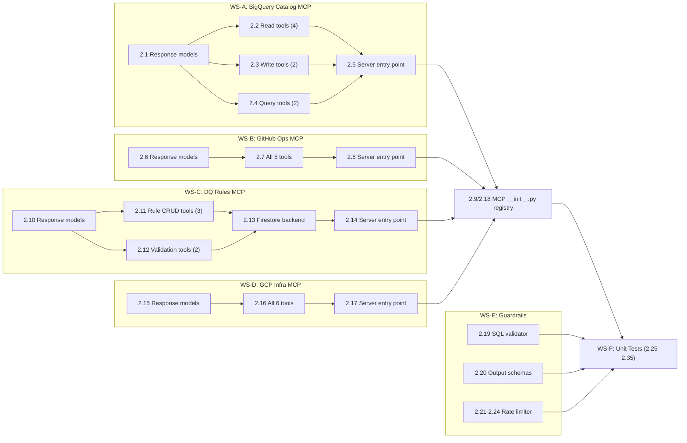

# 🔷 Phase 2: MCP Servers + Guardrails — Detailed Implementation Plan

> **Phase Status:** `[/] In Progress` (no sub-tasks started)  
> **Timeline:** Week 3  
> **Depends on:** Phase 1 ✅ Complete  
> **Target:** All 4 MCP servers running with 24 tools. SQL guardrails blocking destructive ops. Rate limiter enforcing token budgets. All unit tests passing.  
> **Breakpoint Test:** Call each MCP tool independently → verify correct responses. Run `pytest tests/unit/ -v` → all green.

---

## 📋 Task Overview

Phase 2 is divided into **35 granular sub-tasks** across 5 work streams:

| Work Stream | Tasks | Tools/Components |
|:---|:---|:---|
| **WS-A** — MCP Server: BigQuery Catalog | 2.1 – 2.5 | 8 tools + Pydantic response models |
| **WS-B** — MCP Server: GitHub Ops | 2.6 – 2.9 | 5 tools + response models |
| **WS-C** — MCP Server: DQ Rules Engine | 2.10 – 2.14 | 5 tools + Firestore-backed rules + response models |
| **WS-D** — MCP Server: GCP Infra | 2.15 – 2.18 | 6 tools + response models |
| **WS-E** — Guardrails | 2.19 – 2.24 | SQL validator, output schemas, rate limiter |
| **WS-F** — Unit Tests | 2.25 – 2.35 | Tests for all MCP servers + guardrails |



---

## 🏗️ Pre-Requisites Check

Before starting, verify these Phase 1 outputs exist and work:

| Check | How to Verify |
|:---|:---|
| BigQuery dataset `ecommerce` exists | `bq ls --project_id=$PROJECT ecommerce` |
| BigQuery tables (`orders`, `inventory`, `user_activity`, `healing_events`, `trajectory_scores`) | `bq ls ecommerce` |
| Pub/Sub topics (`raw-ecommerce-events`, `pipeline-errors`) | `gcloud pubsub topics list` |
| GCS bucket for Iceberg | `gsutil ls gs://$PROJECT-ecommerce-lakehouse/` |
| Firestore database configured | `gcloud firestore databases list` |
| `backend/app/config.py` has all env vars | Read file, confirm `Settings` class |
| `backend/app/models/` has `events.py`, `enums.py`, `healing.py` | Check files exist with full models |
| `backend/requirements.txt` includes `fastmcp>=2.0.0` | Grep file |

---

## WS-A: BigQuery Catalog MCP Server (Tasks 2.1 – 2.5)

### 📍 File: [`backend/app/mcp_servers/bigquery_catalog.py`](file:///e:/Coding/Projects/Agentic-Self-Healing-Data-Pipeline/backend/app/mcp_servers/bigquery_catalog.py)

**Current state:** Skeleton with `FastMCP("BigQuery Catalog")` instance and TODO comments.

> [!IMPORTANT]
> The `execute_ddl` tool MUST call the SQL validator guardrail before executing any SQL. This is a critical safety requirement from [`CRITICAL_WARNINGS.md`](file:///e:/Coding/Projects/Agentic-Self-Healing-Data-Pipeline/CRITICAL_WARNINGS.md).

---

### Task 2.1 — BigQuery MCP Response Models

**File:** `backend/app/mcp_servers/models/bigquery_models.py` *(new file)*  
**Depends on:** [`backend/app/models/enums.py`](file:///e:/Coding/Projects/Agentic-Self-Healing-Data-Pipeline/backend/app/models/enums.py)  
**Effort:** Small

Define Pydantic v2 response models that all BigQuery MCP tools will return. Every MCP tool must return structured Pydantic models (never raw dicts).

```python
# Models to create:
class ColumnInfo(BaseModel):
    name: str
    field_type: str           # "STRING", "INT64", "FLOAT64", "TIMESTAMP", etc.
    mode: str                 # "NULLABLE", "REQUIRED", "REPEATED"
    description: str = ""

class TableInfo(BaseModel):
    table_id: str
    dataset_id: str
    num_rows: int
    num_bytes: int
    created: datetime
    modified: datetime
    table_type: str           # "TABLE", "VIEW", "EXTERNAL"

class SchemaDefinition(BaseModel):
    table_id: str
    dataset_id: str
    columns: list[ColumnInfo]
    num_rows: int
    last_modified: datetime

class SchemaVersion(BaseModel):
    version: int
    columns: list[ColumnInfo]
    changed_at: datetime
    change_description: str = ""

class SchemaDiff(BaseModel):
    table_id: str
    added_columns: list[ColumnInfo]
    removed_columns: list[ColumnInfo]
    modified_columns: list[dict]      # {column, old_type, new_type}
    is_breaking: bool
    summary: str

class ExecutionResult(BaseModel):
    success: bool
    sql_executed: str
    rows_affected: int = 0
    error_message: str | None = None
    execution_time_ms: int = 0

class QueryResult(BaseModel):
    success: bool
    columns: list[str]
    rows: list[dict]
    total_rows: int
    bytes_processed: int = 0
    error_message: str | None = None

class MCPError(BaseModel):
    """Standard error response from any MCP tool."""
    success: bool = False
    error_code: str
    error_message: str
    details: dict = {}
```

**Done when:** Models importable, `mypy` / `pyright` passes, docstrings present.

---

### Task 2.2 — BigQuery Read Tools (4 tools)

**File:** `backend/app/mcp_servers/bigquery_catalog.py`  
**Depends on:** Task 2.1  
**Effort:** Medium

Implement 4 read-only tools that inspect BigQuery schemas:

| # | Tool | Parameters | Returns | Implementation Notes |
|:---|:---|:---|:---|:---|
| 1 | `list_tables` | `dataset: str` | `list[TableInfo]` | Use `bigquery.Client().list_tables()`. Filter by dataset. |
| 2 | `get_schema` | `table: str` | `SchemaDefinition` | Use `client.get_table()`. Convert `SchemaField` list to `ColumnInfo` list. |
| 3 | `get_schema_history` | `table: str, n: int = 10` | `list[SchemaVersion]` | Query `INFORMATION_SCHEMA.COLUMN_FIELD_PATHS` + `TABLE_OPTIONS` for recent changes. Store schema snapshots in Firestore `schema_versions/{table}/{version}` collection for history tracking. |
| 4 | `compare_schemas` | `table: str, incoming: dict` | `SchemaDiff` | Call `get_schema()` to get current, diff against `incoming` dict, compute `added`, `removed`, `modified`, and `is_breaking`. |

**Implementation pattern for each tool:**

```python
@mcp.tool()
async def list_tables(dataset: str) -> list[TableInfo]:
    """List all tables in a BigQuery dataset.
    
    Args:
        dataset: The BigQuery dataset ID (e.g., 'ecommerce').
    
    Returns:
        List of TableInfo objects with metadata for each table.
    """
    try:
        client = bigquery.Client(project=settings.GCP_PROJECT_ID)
        tables = client.list_tables(dataset)
        return [
            TableInfo(
                table_id=t.table_id,
                dataset_id=t.dataset_id,
                # ... map all fields
            )
            for t in tables
        ]
    except Exception as e:
        raise McpError(f"Failed to list tables: {e}")
```

**Key decisions:**
- Use `google.cloud.bigquery.Client` (already in requirements.txt)
- Get `settings` from [`backend/app/config.py`](file:///e:/Coding/Projects/Agentic-Self-Healing-Data-Pipeline/backend/app/config.py) via `get_settings()`
- All functions must be `async` (FastMCP requirement)
- Wrap GCP SDK sync calls in `asyncio.to_thread()` since BigQuery client is synchronous

**Done when:** Each tool returns correct Pydantic model when called against real BigQuery dataset.

---

### Task 2.3 — BigQuery Write Tools (2 tools)

**File:** `backend/app/mcp_servers/bigquery_catalog.py`  
**Depends on:** Task 2.1, Task 2.19 (SQL validator)  
**Effort:** Medium

| # | Tool | Parameters | Returns | Implementation Notes |
|:---|:---|:---|:---|:---|
| 5 | `execute_ddl` | `sql: str` | `ExecutionResult` | **MUST** call `sql_validator.validate()` before execution. Block if destructive. Log all executions. |
| 6 | `preview_data` | `table: str, limit: int = 10` | `QueryResult` | `SELECT * FROM {table} LIMIT {limit}`. Sanitize table name (no SQL injection). |

> [!CAUTION]
> `execute_ddl` is the most dangerous tool in the system. It MUST:
> 1. Call `SQLValidator.validate(sql)` → check `is_allowed` flag
> 2. If `requires_escalation` → return error asking for HITL approval
> 3. If `is_blocked` → return error with reason, never execute
> 4. Log every execution attempt to `structlog`
> 5. Never accept raw user input — only agent-generated SQL

**Done when:** `execute_ddl` blocks `DROP TABLE`, `TRUNCATE`, `DELETE` without `WHERE`. `preview_data` returns data from a real table.

---

### Task 2.4 — BigQuery Query Tools (2 tools)

**File:** `backend/app/mcp_servers/bigquery_catalog.py`  
**Depends on:** Task 2.1  
**Effort:** Medium

| # | Tool | Parameters | Returns | Implementation Notes |
|:---|:---|:---|:---|:---|
| 7 | `run_query` | `sql: str` | `QueryResult` | Validate SQL is read-only (`SELECT` only). Execute via `client.query()`. Cap results at 1000 rows. |
| 8 | `time_travel_query` | `table: str, timestamp: str, sql: str` | `QueryResult` | Use BigQuery time travel: `FOR SYSTEM_TIME AS OF TIMESTAMP('{timestamp}')`. Validate `timestamp` format. Max 7 days back. |

**Key constraints:**
- `run_query` must reject any non-`SELECT` statement (use the SQL validator's `is_read_only()` method)
- `time_travel_query` must validate the timestamp is within BigQuery's 7-day time travel window
- Both tools must cap result rows (configurable, default 1000) to prevent memory issues

**Done when:** Can query BigQuery and get structured results. Time travel works within 7-day window.

---

### Task 2.5 — BigQuery MCP Server Entry Point

**File:** `backend/app/mcp_servers/bigquery_catalog.py`  
**Depends on:** Tasks 2.2, 2.3, 2.4  
**Effort:** Small

Add the `if __name__ == "__main__"` block so the server can be run standalone:

```python
if __name__ == "__main__":
    mcp.run(transport="stdio")  # stdio for local dev
```

Also add server metadata, health check, and a server-level description:

```python
mcp = FastMCP(
    "BigQuery Catalog",
    description="BigQuery schema inspection, DDL execution, and query tools for the self-healing pipeline.",
)
```

**Done when:** `python -m backend.app.mcp_servers.bigquery_catalog` starts the MCP server and responds to tool calls.

---

## WS-B: GitHub Ops MCP Server (Tasks 2.6 – 2.9)

### 📍 File: [`backend/app/mcp_servers/github_ops.py`](file:///e:/Coding/Projects/Agentic-Self-Healing-Data-Pipeline/backend/app/mcp_servers/github_ops.py)

**Current state:** Skeleton with `FastMCP("GitHub Ops")` instance and TODO comments.

---

### Task 2.6 — GitHub MCP Response Models

**File:** `backend/app/mcp_servers/models/github_models.py` *(new file)*  
**Depends on:** None  
**Effort:** Small

```python
class BranchInfo(BaseModel):
    name: str
    sha: str
    created: bool              # True if newly created, False if already existed
    url: str

class CommitInfo(BaseModel):
    sha: str
    message: str
    author: str
    timestamp: datetime
    url: str
    files_changed: list[str] = []

class PRInfo(BaseModel):
    number: int
    title: str
    body: str
    url: str
    state: str                  # "open", "closed", "merged"
    branch: str
    created_at: datetime

class FileContent(BaseModel):
    path: str
    content: str
    sha: str                    # File blob SHA (needed for updates)
    size: int
    encoding: str = "utf-8"
```

**Done when:** Models importable, all fields documented.

---

### Task 2.7 — GitHub Tools (5 tools)

**File:** `backend/app/mcp_servers/github_ops.py`  
**Depends on:** Task 2.6  
**Effort:** Medium

| # | Tool | Parameters | Returns | Implementation Notes |
|:---|:---|:---|:---|:---|
| 1 | `create_branch` | `branch_name: str, base: str = "main"` | `BranchInfo` | Use `httpx` + GitHub REST API. Get base ref SHA, create ref. |
| 2 | `commit_file` | `path: str, content: str, message: str, branch: str` | `CommitInfo` | PUT `/repos/{owner}/{repo}/contents/{path}`. Handle create vs update (check if file exists first for SHA). |
| 3 | `open_pull_request` | `title: str, body: str, branch: str, base: str = "main"` | `PRInfo` | POST `/repos/{owner}/{repo}/pulls`. |
| 4 | `list_recent_commits` | `n: int = 10, branch: str = "main"` | `list[CommitInfo]` | GET `/repos/{owner}/{repo}/commits?per_page={n}&sha={branch}`. |
| 5 | `get_file_content` | `path: str, branch: str = "main"` | `FileContent` | GET `/repos/{owner}/{repo}/contents/{path}?ref={branch}`. Base64 decode content. |

**Key decisions:**
- Use `httpx.AsyncClient` for GitHub API calls (already in requirements.txt)
- Auth via `GITHUB_TOKEN` from [`config.py`](file:///e:/Coding/Projects/Agentic-Self-Healing-Data-Pipeline/backend/app/config.py) (`settings.GITHUB_TOKEN`)
- Repo from `settings.GITHUB_REPO` (format: `owner/repo`)
- Set `Accept: application/vnd.github.v3+json` header
- All functions async

**Done when:** Can create branch, commit a schema migration file, open a PR, and read files from the configured GitHub repo.

---

### Task 2.8 — GitHub MCP Server Entry Point

**File:** `backend/app/mcp_servers/github_ops.py`  
**Depends on:** Task 2.7  
**Effort:** Small

Add the `if __name__ == "__main__"` block and server metadata. Same pattern as Task 2.5.

**Done when:** Server starts and responds to tool calls.

---

### Task 2.9 — MCP Servers Registry `__init__.py`

**File:** `backend/app/mcp_servers/__init__.py`  
**Depends on:** Tasks 2.5, 2.8, 2.14, 2.18  
**Effort:** Small

Update the `__init__.py` to export all 4 MCP server instances for easy import by the LangGraph agents in Phase 3:

```python
from .bigquery_catalog import mcp as bigquery_mcp
from .github_ops import mcp as github_mcp
from .dq_rules_engine import mcp as dq_rules_mcp
from .gcp_infra import mcp as gcp_infra_mcp

__all__ = ["bigquery_mcp", "github_mcp", "dq_rules_mcp", "gcp_infra_mcp"]
```

**Done when:** All 4 servers importable from `backend.app.mcp_servers`.

---

## WS-C: DQ Rules Engine MCP Server (Tasks 2.10 – 2.14)

### 📍 File: [`backend/app/mcp_servers/dq_rules_engine.py`](file:///e:/Coding/Projects/Agentic-Self-Healing-Data-Pipeline/backend/app/mcp_servers/dq_rules_engine.py)

**Current state:** Skeleton with `FastMCP("DQ Rules Engine")` instance and TODO comments.

> [!NOTE]
> DQ rules are stored in **Firestore** collection `dq_rules/{table_name}/rules/{rule_id}`. This gives us real-time rule updates and easy CRUD. The rules engine does NOT query BigQuery for rule storage — it only queries BigQuery when running validations.

---

### Task 2.10 — DQ Rules Response Models

**File:** `backend/app/mcp_servers/models/dq_models.py` *(new file)*  
**Depends on:** None  
**Effort:** Small

```python
class DQRule(BaseModel):
    rule_id: str
    table: str
    column: str
    rule_type: str             # "not_null", "range", "regex", "enum", "unique", "custom_sql"
    parameters: dict           # e.g., {"min": 0, "max": 9999.99} for range
    severity: str              # "warning", "error", "critical"
    description: str
    enabled: bool = True
    created_at: datetime
    updated_at: datetime

class RuleInfo(BaseModel):
    rule_id: str
    table: str
    created: bool              # True if new, False if updated

class Violation(BaseModel):
    violation_id: str
    rule_id: str
    table: str
    column: str
    rule_type: str
    sample_values: list       # First 5 violating values
    violation_count: int
    total_rows_checked: int
    violation_percentage: float
    detected_at: datetime

class ValidationResult(BaseModel):
    table: str
    total_rows: int
    passed: bool
    violations: list[Violation]
    rules_checked: int
    rules_passed: int
    rules_failed: int
    validated_at: datetime

class BackfillSQL(BaseModel):
    table: str
    violation: Violation
    sql: str
    description: str
    estimated_rows_affected: int
```

**Done when:** Models importable, all fields documented.

---

### Task 2.11 — DQ Rule CRUD Tools (3 tools)

**File:** `backend/app/mcp_servers/dq_rules_engine.py`  
**Depends on:** Task 2.10  
**Effort:** Medium

| # | Tool | Parameters | Returns | Implementation Notes |
|:---|:---|:---|:---|:---|
| 1 | `get_rules` | `table: str` | `list[DQRule]` | Read from Firestore `dq_rules/{table}/rules/`. Filter only `enabled=True`. |
| 2 | `add_rule` | `table: str, rule: DQRule` | `RuleInfo` | Write to Firestore. Auto-generate `rule_id` if not provided. Validate no duplicate rules (same table+column+rule_type). |
| 3 | `get_violations` | `table: str, since: datetime` | `list[Violation]` | Read from Firestore `dq_violations/{table}/` filtered by `detected_at >= since`. |

**Key decisions:**
- Use `google.cloud.firestore.AsyncClient` for async Firestore access
- Rules stored at path `dq_rules/{table_name}/rules/{rule_id}`
- Violations stored at path `dq_violations/{table_name}/violations/{violation_id}`
- Default seed rules should be pre-loaded for `orders`, `inventory`, `user_activity` tables

**Done when:** Rules CRUD works against Firestore. Can add, read, and filter rules.

---

### Task 2.12 — DQ Validation Tools (2 tools)

**File:** `backend/app/mcp_servers/dq_rules_engine.py`  
**Depends on:** Tasks 2.10, 2.11  
**Effort:** Large

| # | Tool | Parameters | Returns | Implementation Notes |
|:---|:---|:---|:---|:---|
| 4 | `validate_batch` | `table: str, data: list[dict]` | `ValidationResult` | Load rules for table via `get_rules()`. Apply each rule to the data batch. Generate `Violation` objects for failures. |
| 5 | `generate_backfill_sql` | `table: str, violation: dict` | `BackfillSQL` | Generate SQL to fix the violation. E.g., null spike → `UPDATE ... SET col = DEFAULT WHERE col IS NULL`. |

**Rule type implementations for `validate_batch`:**

| Rule Type | Validation Logic |
|:---|:---|
| `not_null` | Check `column IS NOT NULL` for all rows |
| `range` | Check `min <= value <= max` using `parameters.min`/`parameters.max` |
| `regex` | Check `re.match(parameters.pattern, value)` for string columns |
| `enum` | Check `value IN parameters.allowed_values` |
| `unique` | Check for duplicate values in `column` across the batch |
| `custom_sql` | Run `parameters.sql` as a BigQuery query (read-only, validated) |

**`generate_backfill_sql` templates by rule type:**

| Rule Type | SQL Template |
|:---|:---|
| `not_null` | `UPDATE {table} SET {col} = {default} WHERE {col} IS NULL` |
| `range` | `UPDATE {table} SET {col} = GREATEST(LEAST({col}, {max}), {min}) WHERE {col} NOT BETWEEN {min} AND {max}` |
| `enum` | `UPDATE {table} SET {col} = '{default}' WHERE {col} NOT IN ({allowed})` |
| `duplicate` | `DELETE FROM {table} WHERE rowid NOT IN (SELECT MIN(rowid) FROM {table} GROUP BY {unique_cols})` |

> [!WARNING]
> The `generate_backfill_sql` tool generates SQL that will be passed through the SQL validator before execution. It should generate UPDATE/DELETE with WHERE clauses — never unqualified DELETEs.

**Done when:** Can validate a batch of events against rules and generate backfill SQL for violations.

---

### Task 2.13 — DQ Seed Rules Loader

**File:** `backend/app/mcp_servers/dq_seed_rules.py` *(new file)*  
**Depends on:** Task 2.11  
**Effort:** Small

Create a one-time script/function to populate Firestore with default DQ rules for all 3 event types:

**Order event rules:**
| Column | Rule Type | Parameters |
|:---|:---|:---|
| `order_id` | `not_null` | — |
| `customer_id` | `not_null` | — |
| `quantity` | `range` | `{"min": 1, "max": 10000}` |
| `unit_price` | `range` | `{"min": 0.01, "max": 99999.99}` |
| `total_amount` | `range` | `{"min": 0.01, "max": 999999.99}` |
| `currency` | `enum` | `{"allowed_values": ["INR", "USD", "EUR", "GBP"]}` |
| `payment_method` | `enum` | `{"allowed_values": ["credit_card", "upi", "cod", "debit_card", "wallet"]}` |
| `status` | `enum` | `{"allowed_values": ["placed", "confirmed", "shipped", "delivered", "cancelled"]}` |
| `event_id` | `unique` | — |

**Inventory event rules:**
| Column | Rule Type | Parameters |
|:---|:---|:---|
| `product_id` | `not_null` | — |
| `warehouse_id` | `regex` | `{"pattern": "^WH-[A-Z]{3}-\\d{2}$"}` |
| `current_stock` | `range` | `{"min": 0, "max": 1000000}` |
| `action` | `enum` | `{"allowed_values": ["restock", "sold", "returned", "damaged", "transferred"]}` |

**User activity event rules:**
| Column | Rule Type | Parameters |
|:---|:---|:---|
| `customer_id` | `not_null` | — |
| `session_id` | `not_null` | — |
| `action` | `enum` | `{"allowed_values": ["page_view", "add_to_cart", "remove_from_cart", "checkout_start", "checkout_complete", "search"]}` |
| `device_type` | `enum` | `{"allowed_values": ["mobile", "desktop", "tablet"]}` |

**Done when:** Running the loader populates Firestore with 15+ rules across 3 tables.

---

### Task 2.14 — DQ Rules MCP Server Entry Point

**File:** `backend/app/mcp_servers/dq_rules_engine.py`  
**Depends on:** Tasks 2.11, 2.12  
**Effort:** Small

Same pattern as Task 2.5. Add `__main__` block and server metadata.

**Done when:** Server starts and responds to all 5 tool calls.

---

## WS-D: GCP Infra MCP Server (Tasks 2.15 – 2.18)

### 📍 File: [`backend/app/mcp_servers/gcp_infra.py`](file:///e:/Coding/Projects/Agentic-Self-Healing-Data-Pipeline/backend/app/mcp_servers/gcp_infra.py)

**Current state:** Skeleton with `FastMCP("GCP Infra")` instance and TODO comments.

---

### Task 2.15 — GCP Infra Response Models

**File:** `backend/app/mcp_servers/models/gcp_infra_models.py` *(new file)*  
**Depends on:** None  
**Effort:** Small

```python
class JobStatus(BaseModel):
    job_id: str
    job_name: str
    state: str                  # "JOB_STATE_RUNNING", "JOB_STATE_DONE", "JOB_STATE_FAILED", etc.
    create_time: datetime
    start_time: datetime | None = None
    current_state_time: datetime
    error_message: str | None = None
    metrics: dict = {}         # {"elements_produced": 1000, "elements_consumed": 950}

class RestartResult(BaseModel):
    success: bool
    old_job_id: str
    new_job_id: str | None = None
    message: str

class BacklogInfo(BaseModel):
    subscription: str
    num_undelivered: int
    oldest_unacked_age_seconds: float
    status: str                # "healthy", "warning", "critical"

class QuotaInfo(BaseModel):
    project_id: str
    queries_per_day_used: int
    queries_per_day_limit: int
    bytes_processed_today: int
    bytes_limit_per_day: int
    slots_used: int
    slots_total: int
    status: str                # "healthy", "approaching_limit", "exceeded"

class LogEntry(BaseModel):
    timestamp: datetime
    severity: str              # "ERROR", "WARNING", "CRITICAL"
    service: str
    message: str
    trace_id: str | None = None
    labels: dict = {}

class ScaleResult(BaseModel):
    success: bool
    service: str
    previous_min_instances: int
    new_min_instances: int
    message: str
```

**Done when:** Models importable, all fields documented.

---

### Task 2.16 — GCP Infra Tools (6 tools)

**File:** `backend/app/mcp_servers/gcp_infra.py`  
**Depends on:** Task 2.15  
**Effort:** Large

| # | Tool | Parameters | Returns | GCP Client / API |
|:---|:---|:---|:---|:---|
| 1 | `get_dataflow_status` | `job_id: str` | `JobStatus` | `google.cloud.dataflow_v1beta3.JobsV1Beta3AsyncClient` |
| 2 | `restart_dataflow` | `job_id: str` | `RestartResult` | Drain current job → launch replacement from template |
| 3 | `get_pubsub_backlog` | `subscription: str` | `BacklogInfo` | `google.cloud.monitoring_v3.MetricServiceClient` → query `pubsub.googleapis.com/subscription/num_undelivered_messages` |
| 4 | `check_bq_quota` | — | `QuotaInfo` | `INFORMATION_SCHEMA.JOBS` for today's usage |
| 5 | `get_error_logs` | `service: str, since: datetime` | `list[LogEntry]` | `google.cloud.logging.Client` → filter by `severity>=ERROR AND resource.type={service}` |
| 6 | `scale_service` | `service: str, min_instances: int` | `ScaleResult` | `google.cloud.run_v2.ServicesClient` → update service `scaling.min_instance_count` |

**Key decisions:**
- Use official Google Cloud Python SDK clients (all already in `requirements.txt`)
- `restart_dataflow` is a **two-step operation**: drain the current job (update state to `JOB_STATE_DRAINING`), then launch a new job from the same template. This is the safest way to restart without data loss.
- `get_pubsub_backlog` uses Cloud Monitoring metrics API (not Pub/Sub admin API) because it's more reliable for backlog metrics
- `scale_service` only adjusts min instances (0-10 range), max instances left to Cloud Run auto-scaling
- `get_error_logs` must limit results (default 50 entries) to prevent huge responses

> [!WARNING]
> `restart_dataflow` and `scale_service` are **mutating operations**. They should be logged and ideally require confirmation from the confidence gate in Phase 3. For now, implement them but add prominent logging.

**Done when:** All 6 tools work against real GCP resources. Dataflow status, Pub/Sub backlog, and error logs retrieved successfully.

---

### Task 2.17 — GCP Infra MCP Server Entry Point

**File:** `backend/app/mcp_servers/gcp_infra.py`  
**Depends on:** Task 2.16  
**Effort:** Small

Same pattern as Task 2.5. Add `__main__` block and server metadata.

**Done when:** Server starts and responds to all 6 tool calls.

---

### Task 2.18 — MCP Models `__init__.py`

**File:** `backend/app/mcp_servers/models/__init__.py` *(new file)*  
**Depends on:** Tasks 2.1, 2.6, 2.10, 2.15  
**Effort:** Small

Create a models directory with `__init__.py` that exports all MCP response models for easy imports:

```python
from .bigquery_models import *
from .github_models import *
from .dq_models import *
from .gcp_infra_models import *
```

**Done when:** All MCP models importable from `backend.app.mcp_servers.models`.

---

## WS-E: Guardrails (Tasks 2.19 – 2.24)

### Task 2.19 — SQL Validator: Core Validation Logic

### 📍 File: [`backend/app/guardrails/sql_validator.py`](file:///e:/Coding/Projects/Agentic-Self-Healing-Data-Pipeline/backend/app/guardrails/sql_validator.py)

**Current state:** Skeleton with TODO comments only.  
**Depends on:** None  
**Effort:** Large

Implement the SQL validator that checks every SQL statement before execution.

**`SQLValidationResult` model:**
```python
class SQLValidationResult(BaseModel):
    is_allowed: bool           # True if SQL can execute safely
    is_read_only: bool         # True if SELECT only
    is_destructive: bool       # True if modifies/deletes data
    requires_escalation: bool  # True if needs HITL approval
    risk_level: str            # "safe", "caution", "dangerous", "blocked"
    blocked_reason: str | None = None
    warnings: list[str] = []
    sanitized_sql: str         # Cleaned SQL (trimmed, comments stripped)
```

**Validation rules:**

```python
# BLOCKED — never execute (return is_allowed=False, is_destructive=True)
BLOCKED_PATTERNS = [
    r"\bDROP\s+TABLE\b",
    r"\bDROP\s+DATABASE\b",
    r"\bDROP\s+SCHEMA\b",
    r"\bTRUNCATE\s+TABLE\b",
    r"\bDELETE\s+FROM\s+\w+\s*$",       # DELETE without WHERE
    r"\bDELETE\s+FROM\s+\w+\s*;",       # DELETE without WHERE (with semicolon)
    r"\bUPDATE\s+\w+\s+SET\s+.*$",      # UPDATE without WHERE
    r"\bGRANT\b",
    r"\bREVOKE\b",
    r"\bALTER\s+TABLE\s+\w+\s+DROP\s+COLUMN\b",
]

# ESCALATION — needs human approval (return requires_escalation=True)
ESCALATION_PATTERNS = [
    r"\bALTER\s+TABLE\s+\w+\s+ALTER\s+COLUMN\s+\w+\s+SET\s+DATA\s+TYPE\b",
    r"\bALTER\s+TABLE\s+\w+\s+RENAME\s+COLUMN\b",
    r"\bALTER\s+TABLE\s+\w+\s+RENAME\s+TO\b",
]

# SAFE — always allow
SAFE_PATTERNS = [
    r"^\s*SELECT\b",
    r"^\s*CREATE\s+TABLE\b",
    r"^\s*CREATE\s+OR\s+REPLACE\s+TABLE\b",
    r"^\s*ALTER\s+TABLE\s+\w+\s+ADD\s+COLUMN\b",
    r"^\s*INSERT\s+INTO\b",
]
```

**Class interface:**
```python
class SQLValidator:
    def validate(self, sql: str) -> SQLValidationResult:
        """Validate a SQL statement and return the validation result."""
        
    def is_read_only(self, sql: str) -> bool:
        """Check if a SQL statement is read-only (SELECT only)."""
        
    def sanitize(self, sql: str) -> str:
        """Strip comments, extra whitespace, and trailing semicolons."""

    def extract_tables(self, sql: str) -> list[str]:
        """Extract table names referenced in the SQL statement."""
```

**Implementation notes:**
- Use `re` module with `re.IGNORECASE` for all pattern matching
- `sanitize()` strips SQL comments (`--`, `/* */`), leading/trailing whitespace, and trailing semicolons
- `validate()` first sanitizes, then checks blocked → escalation → safe patterns in order
- If no pattern matches, default to `requires_escalation=True` (safe by default)
- Log all validation results via `structlog`

**Done when:** Blocks all destructive patterns, escalates type changes, allows safe DDL. All edge cases handled.

---

### Task 2.20 — SQL Validator: Table Allowlist

**File:** `backend/app/guardrails/sql_validator.py`  
**Depends on:** Task 2.19  
**Effort:** Small

Add a table allowlist so SQL can only target known tables:

```python
ALLOWED_TABLES = {
    "ecommerce.orders",
    "ecommerce.inventory",
    "ecommerce.user_activity",
    "ecommerce.healing_events",
    "ecommerce.trajectory_scores",
}
```

The `validate()` method should extract table names and check against the allowlist. If any table is NOT in the allowlist, set `is_allowed=False` with reason `"Table not in allowlist: {table}"`.

**Done when:** SQL referencing unknown tables is blocked.

---

### Task 2.21 — Pydantic Output Schemas

### 📍 File: [`backend/app/guardrails/output_schemas.py`](file:///e:/Coding/Projects/Agentic-Self-Healing-Data-Pipeline/backend/app/guardrails/output_schemas.py)

**Current state:** Skeleton with TODO comments only.  
**Depends on:** [`backend/app/models/enums.py`](file:///e:/Coding/Projects/Agentic-Self-Healing-Data-Pipeline/backend/app/models/enums.py)  
**Effort:** Medium

These are the structured output schemas that Gemini models will be instructed to return. Used in Phase 3 for tool-calling / structured output with LangChain.

```python
class TriageOutput(BaseModel):
    """Structured output from the Triage Agent."""
    error_type: ErrorType
    error_subtype: ErrorSubtype
    severity: Severity
    complexity: Complexity
    model_to_use: str           # "gemini-2.0-flash" or "gemini-2.5-pro"
    reasoning: str              # One-paragraph explanation of classification
    confidence: float = Field(ge=0.0, le=1.0)

class SchemaEvolutionOutput(BaseModel):
    """Structured output from the Schema Evolution Agent."""
    diagnosis: str
    root_cause: str
    proposed_ddl: str           # ALTER TABLE statement
    rollback_ddl: str           # Undo statement
    affected_tables: list[str]
    is_breaking_change: bool
    migration_steps: list[str]  # Ordered list of migration steps
    confidence: float = Field(ge=0.0, le=1.0)

class DataQualityOutput(BaseModel):
    """Structured output from the Data Quality Agent."""
    diagnosis: str
    violations_found: list[dict]  # [{rule_id, column, violation_type, count}]
    proposed_fix_sql: str | None = None
    new_rules_to_add: list[dict] = []  # [{column, rule_type, parameters}]
    backfill_required: bool = False
    estimated_rows_affected: int = 0
    confidence: float = Field(ge=0.0, le=1.0)

class InfraRepairOutput(BaseModel):
    """Structured output from the Infrastructure Repair Agent."""
    diagnosis: str
    root_cause: str
    affected_service: str       # "dataflow", "pubsub", "bigquery", "cloud_run"
    proposed_action: str        # "restart", "scale", "reconfigure", "escalate"
    action_parameters: dict     # e.g., {"job_id": "...", "new_min_instances": 2}
    risk_level: str             # "low", "medium", "high"
    confidence: float = Field(ge=0.0, le=1.0)

class ConfidenceAssessment(BaseModel):
    """Confidence gate output — decides auto-apply vs escalation."""
    overall_confidence: float = Field(ge=0.0, le=1.0)
    is_destructive: bool
    requires_approval: bool
    approval_tier: int          # 0=auto, 1=dashboard, 2=slack+dashboard, 3=critical
    reasoning: str
    risk_factors: list[str] = []
```

**Done when:** All 5 output schemas importable. Fields validated with Pydantic constraints. Docstrings explain each field.

---

### Task 2.22 — Rate Limiter: Core Logic

### 📍 File: [`backend/app/guardrails/rate_limiter.py`](file:///e:/Coding/Projects/Agentic-Self-Healing-Data-Pipeline/backend/app/guardrails/rate_limiter.py)

**Current state:** Skeleton with TODO comments only.  
**Depends on:** [`backend/app/config.py`](file:///e:/Coding/Projects/Agentic-Self-Healing-Data-Pipeline/backend/app/config.py) for budget constants  
**Effort:** Medium

Implement a token-bucket rate limiter that tracks LLM token usage.

**`TokenUsage` model:**
```python
class TokenUsage(BaseModel):
    input_tokens: int = 0
    output_tokens: int = 0
    total_tokens: int = 0
    model: str = ""
    timestamp: datetime = Field(default_factory=datetime.utcnow)

class RateLimitResult(BaseModel):
    allowed: bool
    remaining_event_budget: int
    remaining_hourly_budget: int
    current_event_usage: int
    current_hourly_usage: int
    reason: str | None = None
```

**Class interface:**
```python
class RateLimiter:
    def __init__(
        self,
        per_event_budget: int = 100_000,   # From settings
        per_hour_budget: int = 1_000_000,  # From settings
    ):
        self._event_usage: dict[str, int] = {}   # healing_id -> tokens used
        self._hourly_usage: list[TokenUsage] = []  # sliding window
    
    def check_budget(self, healing_id: str, estimated_tokens: int) -> RateLimitResult:
        """Check if a request is within budget before making an LLM call."""
        
    def record_usage(self, healing_id: str, usage: TokenUsage) -> None:
        """Record actual token usage after an LLM call completes."""
        
    def get_event_usage(self, healing_id: str) -> int:
        """Get total tokens used for a specific healing event."""
    
    def get_hourly_usage(self) -> int:
        """Get total tokens used in the current sliding 1-hour window."""
    
    def reset_event(self, healing_id: str) -> None:
        """Clear tracking for a completed healing event."""
    
    def _cleanup_expired(self) -> None:
        """Remove token records older than 1 hour from hourly tracking."""
```

**Implementation notes:**
- Use a sliding window for hourly tracking (keep `TokenUsage` entries from the last hour, sum them)
- Thread-safe: use `asyncio.Lock` for concurrent access
- `check_budget()` returns `allowed=False` if either per-event or per-hour budget would be exceeded
- Log budget warnings at 80% usage via `structlog`

**Done when:** Rate limiter correctly enforces both per-event and per-hour budgets. Concurrent access is safe.

---

### Task 2.23 — Rate Limiter: Per-Model Tracking

**File:** `backend/app/guardrails/rate_limiter.py`  
**Depends on:** Task 2.22  
**Effort:** Small

Extend the rate limiter to track usage per model (Flash vs Pro separately):

```python
def get_model_usage(self, model: str) -> dict:
    """Get usage breakdown for a specific model."""
    # Returns: {"input_tokens": ..., "output_tokens": ..., "total_tokens": ..., "call_count": ...}

def get_usage_summary(self) -> dict:
    """Get full usage summary across all models and events."""
    # Returns breakdown by model, by event, totals, and remaining budgets
```

This data feeds into the Cost Tracker dashboard page in Phase 4.

**Done when:** Can query token usage broken down by model type.

---

### Task 2.24 — Guardrails `__init__.py`

**File:** `backend/app/guardrails/__init__.py`  
**Depends on:** Tasks 2.19-2.23  
**Effort:** Small

Export the three guardrail components:

```python
from .sql_validator import SQLValidator, SQLValidationResult
from .output_schemas import (
    TriageOutput,
    SchemaEvolutionOutput,
    DataQualityOutput,
    InfraRepairOutput,
    ConfidenceAssessment,
)
from .rate_limiter import RateLimiter, RateLimitResult, TokenUsage

__all__ = [
    "SQLValidator", "SQLValidationResult",
    "TriageOutput", "SchemaEvolutionOutput", "DataQualityOutput",
    "InfraRepairOutput", "ConfidenceAssessment",
    "RateLimiter", "RateLimitResult", "TokenUsage",
]
```

**Done when:** All guardrails importable from `backend.app.guardrails`.

---

## WS-F: Unit Tests (Tasks 2.25 – 2.35)

### 📍 Directory: `backend/tests/unit/`

**Current state:** Only `__init__.py` exists. No test files.

> [!TIP]
> All tests should use `pytest` + `pytest-asyncio`. Mock GCP clients using `unittest.mock.patch` and `unittest.mock.AsyncMock`. Never call real GCP APIs in unit tests.

---

### Task 2.25 — Test Fixtures & Conftest

**File:** `backend/tests/conftest.py` *(new file)*  
**Depends on:** None  
**Effort:** Small

Create shared test fixtures:

```python
import pytest
from unittest.mock import MagicMock, AsyncMock, patch

@pytest.fixture
def mock_bq_client():
    """Mock BigQuery client with standard table/schema responses."""
    ...

@pytest.fixture
def mock_firestore_client():
    """Mock Firestore client for DQ rules."""
    ...

@pytest.fixture
def mock_github_token():
    """Mock GitHub API token."""
    ...

@pytest.fixture
def sample_order_event():
    """Valid order event dict."""
    ...

@pytest.fixture
def sample_error_event():
    """Sample error event from Pub/Sub."""
    ...

@pytest.fixture
def sample_schema():
    """Sample BigQuery schema for orders table."""
    ...

@pytest.fixture
def sql_validator():
    """SQLValidator instance."""
    from backend.app.guardrails.sql_validator import SQLValidator
    return SQLValidator()

@pytest.fixture
def rate_limiter():
    """RateLimiter instance with test budgets."""
    from backend.app.guardrails.rate_limiter import RateLimiter
    return RateLimiter(per_event_budget=1000, per_hour_budget=5000)
```

**Done when:** Conftest provides reusable fixtures for all test files.

---

### Task 2.26 — Tests: BigQuery MCP — Read Tools

**File:** `backend/tests/unit/test_mcp_bigquery_read.py` *(new file)*  
**Depends on:** Tasks 2.2, 2.25  
**Effort:** Medium

Test cases:
- `test_list_tables_returns_table_info` — Mock BQ client, verify `list[TableInfo]` response
- `test_list_tables_empty_dataset` — Empty dataset returns empty list
- `test_list_tables_invalid_dataset` — Non-existent dataset raises/returns error
- `test_get_schema_returns_columns` — Mock table with known schema, verify all columns mapped
- `test_get_schema_nonexistent_table` — Returns error
- `test_get_schema_history_returns_versions` — Mock Firestore schema versions
- `test_compare_schemas_detects_new_column` — Incoming schema has extra column → `added_columns` populated
- `test_compare_schemas_detects_removed_column` — Incoming schema missing column → `removed_columns` populated
- `test_compare_schemas_detects_type_change` — Column type changed → `modified_columns` populated, `is_breaking=True`
- `test_compare_schemas_no_diff` — Identical schemas → empty diff

**Done when:** 10 tests, all passing.

---

### Task 2.27 — Tests: BigQuery MCP — Write & Query Tools

**File:** `backend/tests/unit/test_mcp_bigquery_write.py` *(new file)*  
**Depends on:** Tasks 2.3, 2.4, 2.25  
**Effort:** Medium

Test cases:
- `test_execute_ddl_safe_sql` — `ALTER TABLE ADD COLUMN` → `success=True`
- `test_execute_ddl_blocked_sql` — `DROP TABLE` → blocked, `success=False`
- `test_execute_ddl_escalation_sql` — `ALTER COLUMN TYPE` → `requires_escalation`
- `test_execute_ddl_calls_sql_validator` — Verify `SQLValidator.validate()` is called
- `test_preview_data_returns_rows` — Mock query results, verify `QueryResult`
- `test_preview_data_respects_limit` — Limit parameter passed to query
- `test_run_query_read_only` — `SELECT` statement succeeds
- `test_run_query_rejects_write` — `INSERT` statement rejected
- `test_time_travel_valid_timestamp` — Within 7 days, succeeds
- `test_time_travel_too_old` — More than 7 days ago, rejected

**Done when:** 10 tests, all passing.

---

### Task 2.28 — Tests: GitHub MCP

**File:** `backend/tests/unit/test_mcp_github.py` *(new file)*  
**Depends on:** Tasks 2.7, 2.25  
**Effort:** Medium

Test cases (all mock `httpx` responses):
- `test_create_branch_success` — Creates branch, returns `BranchInfo`
- `test_create_branch_already_exists` — Returns `created=False`
- `test_commit_file_new_file` — Creates new file, returns `CommitInfo`
- `test_commit_file_update` — Updates existing file (provides SHA)
- `test_open_pull_request_success` — Returns `PRInfo` with URL
- `test_open_pull_request_duplicate` — PR already exists, handles gracefully
- `test_list_recent_commits` — Returns `list[CommitInfo]` with correct count
- `test_get_file_content_success` — Returns decoded content
- `test_get_file_content_not_found` — Returns error for missing file
- `test_github_auth_header` — Verify `Authorization: token {GITHUB_TOKEN}` header sent

**Done when:** 10 tests, all passing.

---

### Task 2.29 — Tests: DQ Rules MCP — CRUD

**File:** `backend/tests/unit/test_mcp_dq_rules.py` *(new file)*  
**Depends on:** Tasks 2.11, 2.25  
**Effort:** Medium

Test cases:
- `test_get_rules_returns_rules` — Mock Firestore, verify `list[DQRule]`
- `test_get_rules_filters_disabled` — Only `enabled=True` rules returned
- `test_get_rules_empty_table` — No rules → empty list
- `test_add_rule_success` — Creates new rule in Firestore
- `test_add_rule_duplicate_rejected` — Same table+column+rule_type blocked
- `test_get_violations_success` — Returns violations after `since` timestamp
- `test_get_violations_empty` — No violations → empty list

**Done when:** 7 tests, all passing.

---

### Task 2.30 — Tests: DQ Rules MCP — Validation

**File:** `backend/tests/unit/test_mcp_dq_validation.py` *(new file)*  
**Depends on:** Tasks 2.12, 2.25  
**Effort:** Medium

Test cases:
- `test_validate_batch_all_pass` — Clean data → `passed=True`, no violations
- `test_validate_batch_null_violation` — Null in `not_null` column → violation detected
- `test_validate_batch_range_violation` — `quantity = -5` → out of range violation
- `test_validate_batch_enum_violation` — Invalid `payment_method` → enum violation
- `test_validate_batch_regex_violation` — Bad `warehouse_id` format → regex violation
- `test_validate_batch_multiple_violations` — Multiple rules fail → all violations reported
- `test_generate_backfill_null` — Generates correct `UPDATE ... SET col = DEFAULT WHERE col IS NULL`
- `test_generate_backfill_range` — Generates correct clamping SQL
- `test_generate_backfill_enum` — Generates correct replacement SQL

**Done when:** 9 tests, all passing.

---

### Task 2.31 — Tests: GCP Infra MCP

**File:** `backend/tests/unit/test_mcp_gcp_infra.py` *(new file)*  
**Depends on:** Tasks 2.16, 2.25  
**Effort:** Medium

Test cases:
- `test_get_dataflow_status_running` — Mock running job → `state="JOB_STATE_RUNNING"`
- `test_get_dataflow_status_failed` — Mock failed job → includes `error_message`
- `test_restart_dataflow_success` — Mock drain + relaunch → returns new `job_id`
- `test_get_pubsub_backlog_healthy` — Low backlog → `status="healthy"`
- `test_get_pubsub_backlog_critical` — High backlog → `status="critical"`
- `test_check_bq_quota_healthy` — Under limits → `status="healthy"`
- `test_check_bq_quota_approaching` — Near limits → `status="approaching_limit"`
- `test_get_error_logs_returns_entries` — Mock log entries returned
- `test_get_error_logs_empty` — No errors → empty list
- `test_scale_service_success` — Scale up → returns new min instances

**Done when:** 10 tests, all passing.

---

### Task 2.32 — Tests: SQL Validator

**File:** `backend/tests/unit/test_sql_validator.py` *(new file)*  
**Depends on:** Tasks 2.19, 2.20, 2.25  
**Effort:** Large

Test cases:

**Blocked SQL (must return `is_allowed=False`):**
- `test_blocks_drop_table` — `DROP TABLE ecommerce.orders`
- `test_blocks_drop_database` — `DROP DATABASE ecommerce`
- `test_blocks_truncate` — `TRUNCATE TABLE ecommerce.orders`
- `test_blocks_delete_without_where` — `DELETE FROM ecommerce.orders`
- `test_blocks_update_without_where` — `UPDATE ecommerce.orders SET status='cancelled'`
- `test_blocks_grant` — `GRANT SELECT ON ecommerce.orders TO user`
- `test_blocks_alter_drop_column` — `ALTER TABLE ecommerce.orders DROP COLUMN status`

**Escalation SQL (must return `requires_escalation=True`):**
- `test_escalates_alter_type` — `ALTER TABLE ecommerce.orders ALTER COLUMN quantity SET DATA TYPE STRING`
- `test_escalates_rename_column` — `ALTER TABLE ecommerce.orders RENAME COLUMN unit_price TO price_per_unit`
- `test_escalates_rename_table` — `ALTER TABLE ecommerce.orders RENAME TO ecommerce.orders_v2`

**Safe SQL (must return `is_allowed=True`):**
- `test_allows_select` — `SELECT * FROM ecommerce.orders LIMIT 10`
- `test_allows_add_column` — `ALTER TABLE ecommerce.orders ADD COLUMN loyalty_points INT64`
- `test_allows_create_table` — `CREATE TABLE ecommerce.temp (...)`
- `test_allows_insert` — `INSERT INTO ecommerce.healing_events (...) VALUES (...)`
- `test_allows_delete_with_where` — `DELETE FROM ecommerce.orders WHERE order_id = 'test'`
- `test_allows_update_with_where` — `UPDATE ecommerce.orders SET status='cancelled' WHERE order_id = 'test'`

**Edge cases:**
- `test_case_insensitive` — `drop TABLE`, `Drop table` both blocked
- `test_sql_with_comments` — `-- comment\nDROP TABLE orders` blocked after comment stripping
- `test_multiline_sql` — Multi-line DDL handled correctly
- `test_unknown_table_blocked` — `SELECT * FROM unknown_table` blocked by allowlist
- `test_sanitize_strips_semicolons` — Trailing `;` removed
- `test_empty_sql_blocked` — Empty string returns `is_allowed=False`

**Done when:** 23 tests, all passing. 100% coverage on `sql_validator.py`.

---

### Task 2.33 — Tests: Output Schemas

**File:** `backend/tests/unit/test_output_schemas.py` *(new file)*  
**Depends on:** Task 2.21, 2.25  
**Effort:** Small

Test cases:
- `test_triage_output_valid` — Valid data → model creates successfully
- `test_triage_output_invalid_confidence` — `confidence=1.5` → `ValidationError`
- `test_triage_output_invalid_error_type` — Bad enum → `ValidationError`
- `test_schema_evolution_output_valid` — Valid data → model creates
- `test_data_quality_output_valid` — Valid data → model creates
- `test_infra_repair_output_valid` — Valid data → model creates
- `test_confidence_assessment_valid` — Valid data → model creates
- `test_confidence_assessment_invalid_tier` — Boundary check

**Done when:** 8 tests, all passing.

---

### Task 2.34 — Tests: Rate Limiter

**File:** `backend/tests/unit/test_rate_limiter.py` *(new file)*  
**Depends on:** Tasks 2.22, 2.23, 2.25  
**Effort:** Medium

Test cases:
- `test_check_budget_within_limit` — Under budget → `allowed=True`
- `test_check_budget_exceeds_event_limit` — Over per-event budget → `allowed=False`
- `test_check_budget_exceeds_hourly_limit` — Over per-hour budget → `allowed=False`
- `test_record_usage_updates_counters` — Usage recorded correctly
- `test_get_event_usage` — Returns correct total for healing_id
- `test_get_hourly_usage_sliding_window` — Old entries excluded after 1 hour
- `test_reset_event_clears_tracking` — Event tracking cleared
- `test_get_model_usage_breakdown` — Flash vs Pro tracked separately
- `test_concurrent_access_safe` — Multiple async tasks don't corrupt state
- `test_get_usage_summary` — Full summary with all breakdowns

**Done when:** 10 tests, all passing.

---

### Task 2.35 — Phase 2 Breakpoint Test

**Depends on:** All tasks 2.1 – 2.34  
**Effort:** Small

Run the full test suite and verify:

```bash
cd backend && pytest tests/unit/ -v --cov=app --cov-report=term-missing
```

**Pass criteria:**
- [ ] All unit tests pass (97+ tests total)
- [ ] Coverage on `mcp_servers/` > 85%
- [ ] Coverage on `guardrails/` > 90%
- [ ] No `structlog` errors or warnings in test output
- [ ] Each MCP server starts standalone: `python -m backend.app.mcp_servers.{name}`

---

## 📊 Summary: Task Dependency Graph

```mermaid
flowchart TD
    subgraph "Response Models (Parallel)"
        M1["2.1 BQ Models"]
        M2["2.6 GitHub Models"]
        M3["2.10 DQ Models"]
        M4["2.15 GCP Models"]
    end

    subgraph "Guardrails (Parallel with Models)"
        G1["2.19 SQL Validator Core"]
        G2["2.20 SQL Table Allowlist"]
        G3["2.21 Output Schemas"]
        G4["2.22 Rate Limiter Core"]
        G5["2.23 Rate Limiter Per-Model"]
        G1 --> G2
        G4 --> G5
    end

    subgraph "MCP Tools"
        M1 --> T1["2.2 BQ Read Tools"]
        M1 --> T2["2.3 BQ Write Tools"]
        M1 --> T3["2.4 BQ Query Tools"]
        G1 --> T2
        M2 --> T4["2.7 GitHub Tools"]
        M3 --> T5["2.11 DQ CRUD Tools"]
        M3 --> T6["2.12 DQ Validation Tools"]
        T5 --> T6
        T5 --> T7["2.13 DQ Seed Rules"]
        M4 --> T8["2.16 GCP Infra Tools"]
    end

    subgraph "Entry Points"
        T1 & T2 & T3 --> E1["2.5 BQ Entry Point"]
        T4 --> E2["2.8 GitHub Entry Point"]
        T5 & T6 --> E3["2.14 DQ Entry Point"]
        T8 --> E4["2.17 GCP Entry Point"]
        E1 & E2 & E3 & E4 --> R["2.9 MCP Registry"]
        M1 & M2 & M3 & M4 --> MI["2.18 Models __init__"]
        G1 & G2 & G3 & G4 & G5 --> GI["2.24 Guardrails __init__"]
    end

    subgraph "Tests"
        T1 --> UT1["2.26 Test BQ Read"]
        T2 & T3 --> UT2["2.27 Test BQ Write"]
        T4 --> UT3["2.28 Test GitHub"]
        T5 --> UT4["2.29 Test DQ CRUD"]
        T6 --> UT5["2.30 Test DQ Validation"]
        T8 --> UT6["2.31 Test GCP Infra"]
        G1 & G2 --> UT7["2.32 Test SQL Validator"]
        G3 --> UT8["2.33 Test Output Schemas"]
        G4 & G5 --> UT9["2.34 Test Rate Limiter"]
    end

    UT1 & UT2 & UT3 & UT4 & UT5 & UT6 & UT7 & UT8 & UT9 --> BP["2.35 BREAKPOINT TEST"]

    CF["2.25 Test Conftest"] --> UT1 & UT2 & UT3 & UT4 & UT5 & UT6 & UT7 & UT8 & UT9
```



---

## 📁 New Files Created in Phase 2

| # | File Path | Type |
|:---|:---|:---|
| 1 | `backend/app/mcp_servers/models/__init__.py` | Package init |
| 2 | `backend/app/mcp_servers/models/bigquery_models.py` | Response models |
| 3 | `backend/app/mcp_servers/models/github_models.py` | Response models |
| 4 | `backend/app/mcp_servers/models/dq_models.py` | Response models |
| 5 | `backend/app/mcp_servers/models/gcp_infra_models.py` | Response models |
| 6 | `backend/app/mcp_servers/dq_seed_rules.py` | Seed data loader |
| 7 | `backend/tests/conftest.py` | Test fixtures |
| 8 | `backend/tests/unit/test_mcp_bigquery_read.py` | Unit tests |
| 9 | `backend/tests/unit/test_mcp_bigquery_write.py` | Unit tests |
| 10 | `backend/tests/unit/test_mcp_github.py` | Unit tests |
| 11 | `backend/tests/unit/test_mcp_dq_rules.py` | Unit tests |
| 12 | `backend/tests/unit/test_mcp_dq_validation.py` | Unit tests |
| 13 | `backend/tests/unit/test_mcp_gcp_infra.py` | Unit tests |
| 14 | `backend/tests/unit/test_sql_validator.py` | Unit tests |
| 15 | `backend/tests/unit/test_output_schemas.py` | Unit tests |
| 16 | `backend/tests/unit/test_rate_limiter.py` | Unit tests |

## 📝 Existing Files Modified in Phase 2

| # | File Path | What Changes |
|:---|:---|:---|
| 1 | `backend/app/mcp_servers/__init__.py` | Add exports for all 4 MCP servers |
| 2 | `backend/app/mcp_servers/bigquery_catalog.py` | Full implementation (8 tools) |
| 3 | `backend/app/mcp_servers/github_ops.py` | Full implementation (5 tools) |
| 4 | `backend/app/mcp_servers/dq_rules_engine.py` | Full implementation (5 tools) |
| 5 | `backend/app/mcp_servers/gcp_infra.py` | Full implementation (6 tools) |
| 6 | `backend/app/guardrails/__init__.py` | Add exports for all guardrails |
| 7 | `backend/app/guardrails/sql_validator.py` | Full implementation |
| 8 | `backend/app/guardrails/output_schemas.py` | Full implementation |
| 9 | `backend/app/guardrails/rate_limiter.py` | Full implementation |

---

## ⏱️ Estimated Effort by Task

| Task ID | Description | Effort | Est. Time |
|:---|:---|:---|:---|
| 2.1 | BQ Response Models | Small | 30 min |
| 2.2 | BQ Read Tools (4) | Medium | 1.5 hr |
| 2.3 | BQ Write Tools (2) | Medium | 1 hr |
| 2.4 | BQ Query Tools (2) | Medium | 1 hr |
| 2.5 | BQ Entry Point | Small | 15 min |
| 2.6 | GitHub Response Models | Small | 30 min |
| 2.7 | GitHub Tools (5) | Medium | 1.5 hr |
| 2.8 | GitHub Entry Point | Small | 15 min |
| 2.9 | MCP Registry | Small | 15 min |
| 2.10 | DQ Response Models | Small | 30 min |
| 2.11 | DQ CRUD Tools (3) | Medium | 1 hr |
| 2.12 | DQ Validation Tools (2) | Large | 2 hr |
| 2.13 | DQ Seed Rules | Small | 30 min |
| 2.14 | DQ Entry Point | Small | 15 min |
| 2.15 | GCP Infra Response Models | Small | 30 min |
| 2.16 | GCP Infra Tools (6) | Large | 2.5 hr |
| 2.17 | GCP Entry Point | Small | 15 min |
| 2.18 | MCP Models init | Small | 15 min |
| 2.19 | SQL Validator Core | Large | 1.5 hr |
| 2.20 | SQL Table Allowlist | Small | 30 min |
| 2.21 | Output Schemas | Medium | 1 hr |
| 2.22 | Rate Limiter Core | Medium | 1.5 hr |
| 2.23 | Rate Limiter Per-Model | Small | 30 min |
| 2.24 | Guardrails init | Small | 15 min |
| 2.25 | Test Conftest | Small | 30 min |
| 2.26 | Test BQ Read | Medium | 1 hr |
| 2.27 | Test BQ Write | Medium | 1 hr |
| 2.28 | Test GitHub | Medium | 1 hr |
| 2.29 | Test DQ CRUD | Medium | 45 min |
| 2.30 | Test DQ Validation | Medium | 1 hr |
| 2.31 | Test GCP Infra | Medium | 1 hr |
| 2.32 | Test SQL Validator | Large | 1.5 hr |
| 2.33 | Test Output Schemas | Small | 30 min |
| 2.34 | Test Rate Limiter | Medium | 1 hr |
| 2.35 | Breakpoint Test | Small | 15 min |
| | **TOTAL** | | **~27 hours** |

---

## 🚀 Recommended Execution Order

These are parallelizable work streams. Here's the optimal order:

**Batch 1 — Foundation (can all run in parallel):**
- 2.1 + 2.6 + 2.10 + 2.15 (all response models)
- 2.19 + 2.20 (SQL validator — needed by BQ MCP)
- 2.21 (output schemas — independent)
- 2.22 + 2.23 (rate limiter — independent)
- 2.25 (test conftest — independent)

**Batch 2 — MCP Tools (after their response models + SQL validator):**
- 2.2 + 2.3 + 2.4 + 2.5 (BigQuery MCP — needs 2.1, 2.19)
- 2.7 + 2.8 (GitHub MCP — needs 2.6)
- 2.11 + 2.12 + 2.13 + 2.14 (DQ Rules MCP — needs 2.10)
- 2.16 + 2.17 (GCP Infra MCP — needs 2.15)

**Batch 3 — Registry & Inits (after all tools):**
- 2.9 + 2.18 + 2.24

**Batch 4 — Tests (after implementation):**
- 2.26 – 2.34 (all test files)

**Batch 5 — Breakpoint:**
- 2.35 (run everything, verify)
